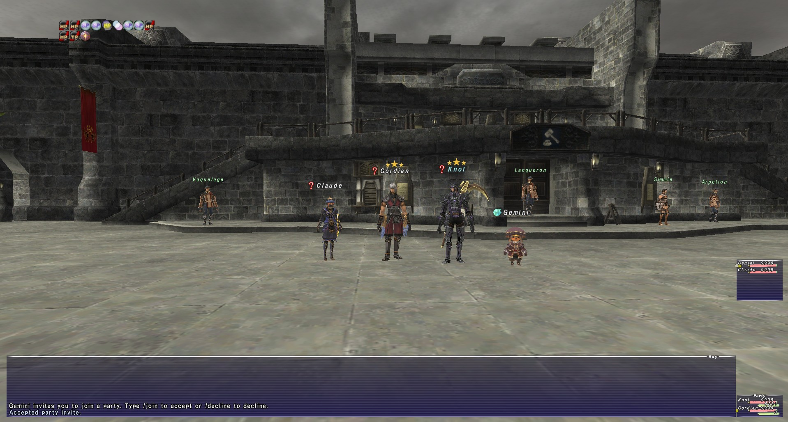

# GordianXI

[](https://dotnet.microsoft.com/)
[](https://avaloniatechnologies.com/)
[](LICENSE)
[](https://scorecard.dev/viewer/?uri=github.com/jimmy58663/GordianXI)

**GordianXI** is a next-generation, open-source custom client architecture for Final Fantasy XI built from scratch in modern **C# (.NET 10)**. 

By replacing the legacy 2002 executable entirely, GordianXI cuts through decades of technical debt, shifts multi-boxing from a brittle hacking exercise into a native design feature, and permanently shatters the structural memory constraints of the original client.

> ⚠️ **Disclaimer & Legal Boundary:** GordianXI is an independent, clean-room software preservation project. It does **not** contain, host, or distribute any copyrighted assets, 3D models, textures, or proprietary code belonging to Square Enix. Users must possess a legally installed, official retail copy of Final Fantasy XI. GordianXI functions purely as an alternative execution runtime that reads local resource data files directly from the user's hard drive. For comprehensive legal terms, trademark disclaimers, and reverse-engineering statutory protections, see [LEGAL.md](LEGAL.md).

---

## 📸 Screenshots

Every scene below is rendered by GordianXI itself from the retail `.dat` files of a local Final Fantasy XI installation.

<!-- Gallery: add images to docs/images/ and a <td> cell per screenshot, two cells per row. -->
<table>
  <tr>
    <td align="center" colspan="2">
      <a href="docs/images/southern_sandoria_ah.jpg"></a>
      <br><sub><b>Southern San d'Oria</b> · auction house plaza with player and NPC models</sub>
    </td>
  </tr>
</table>

---

## ✨ Core Pillars & Architectural Features

*   **⚡ Permanent 64-Bit Memory Scaling:** Compiling natively as an `x64` application completely eliminates the legacy 32-bit 4 GB RAM ceiling. GordianXI can stream extensive community high-definition texture packages and heavy zone geometries directly into memory simultaneously without encountering allocation crashes.
*   **👥 Native Single-Process Multi-Boxing:** Bypasses all unstable Windows IPC methods (`//send`) entirely. All characters exist as native entities in a single, unified memory block. While your active viewport gets full 3D rendering, background characters are transitioned into a highly efficient **"headless" state**—processing only their packet streams, positioning, and script logic to minimize hardware overhead.
*   **🤖 Integrated Group Coordinator:** Eliminates dropped macros and action synchronization lag by embedding core coordination parameters directly into a dedicated engine subsystem. Background character entities read a shared team data array instantaneously, executing synchronized actions down to the exact millisecond.
*   **🛑 Server-Authoritative Kill-Switch:** Built with a fully decoupled, optional design. Private server administrators can transmit a feature flag payload to remotely lock down or completely disable the automation engine at runtime. The client natively honors server-enforced rules without breaking core game functionality.
*   **🧩 Sandboxed Lua Scripting & Dear ImGui:** Houses a secure, allowlist-sandboxed Lua 5.4 (KeraLua P/Invoke) scripting runtime with a native Gordian addon API, plus a clearly separated compatibility layer for existing `GearSwap` profiles and Windower/Ashita-style addons — addon scripts execute inside a restricted environment exposing only a deliberately curated API surface, with no path to the .NET CLR, raw filesystem APIs, or OS process control. Addons instead get a scoped, quota-bound storage API confined to their own data directory for config and logs. It includes a native **Dear ImGui** layer (Hexa.NET.ImGui) to render modern, rounded, translucent HUD overlays with zero Garbage Collection allocation overhead.

---

## 🏗️ Repository Architecture

GordianXI is organized as a monorepo of five layered .NET 10 assemblies plus the small native handoff proxy. Each layer references only the ones below it, and tests enforce the boundaries (see [docs/architecture.md](docs/architecture.md)):

```text
Gordian.App ──► Gordian.Engine ──► Gordian.Core
Gordian.App ──► Gordian.Addons ──► Gordian.Core
Gordian.App ──► Gordian.Automation ──► Gordian.Core
```

```text
GordianXI/
├── GordianXI.slnx          # Solution
├── src/
│   ├── Gordian.Core/       # Class Library: protocol, session, world and entity state, DAT resources, config, diagnostics
│   ├── Gordian.Engine/     # Class Library: playback, events, audio, input, macros, stock UI state, per-character sessions
│   ├── Gordian.Automation/ # Class Library: optional automation (Gambits, pathing, target sync)
│   ├── Gordian.Addons/     # Class Library: sandboxed Lua 5.4 addon runtime
│   ├── Gordian.App/        # Avalonia UI app: desktop shell, GPU renderer, audio output, input devices, ImGui
│   └── Gordian.Proxy/      # Native FFXiMain.dll proxy for the bootloader session handoff (Windows)
├── tests/                  # One test project per assembly (Core.Tests also covers the engine for now)
└── docs/                   # How each subsystem works (index: docs/README.md)
```

*   **`Gordian.Core`:** The backbone of the application, and plain .NET with no GPU, audio or UI packages. Manages the network streams, Blowfish, UDP framing and the zero-allocation packet decoders (`Span<byte>`), and holds the neutral shared state everything else reads: world and entity state (including collision and per-entity animation state), DAT resources and the VFS, and config, including the server's `FeatureRestrictions` kill-switch. It knows nothing about the layers above it.
*   **`Gordian.Engine`:** Everything that plays, presents or takes input on top of Core's state: action and animation playback, the event VM and NPC dialog, retail sound decoding, CPU-side particles and effects, the camera, input and macros, the stock UI's state and text, and `CharacterSession`, which builds and wires one character's client. Still no GPU, audio or UI packages, so it runs headless.
*   **`Gordian.Automation`:** The tactical logic engine. Houses the FFXII-style Gambit queues, positional multi-box tracking loops, and automation threads. It reads `Gordian.Core` state as an optional passenger module and never references the engine or the addon runtime.
*   **`Gordian.Addons`:** The extension ecosystem sandbox. Isolates community-built scripts and modules, ensuring that an error or infinite loop inside a user script can never freeze the main client loop or crash the engine. Like Automation, it references `Gordian.Core` only.
*   **`Gordian.App`:** The graphical user interface built with **Avalonia UI**. Handles desktop windows and pop-out layouts for background characters, and hosts the device-facing pieces: the GPU renderer (NeoVeldrid on Direct3D 11 / Vulkan), OpenAL output, SDL gamepad input and the Dear ImGui overlay.

---

## 🗺️ Roadmap & Phase Strategy

Development follows a minimum viable product (MVP) lifecycle. Live status is in **[ROADMAP.md](ROADMAP.md)**, and open work is in [GitHub Issues](https://github.com/jimmy58663/GordianXI/issues), grouped by milestone.

*   **Phases 1-4 (done):** the foundation and desktop shell, bootloader handoff and direct LandSandBoat login, the full packet engine with zone transitions, and world state with the DAT resource pipeline and VFS.
*   **Phase 5 (current focus, MVP):** the 3D viewport (zone terrain, sky and weather, entity models, skeletal and combat animation), collision, the character lobby, audio, and the retail stock UI, the last of which is still being finished.
*   **Phases 6-10 (post-MVP):** the sandboxed Lua addon runtime, the Gambit automation engine with the server kill-switch, multi-instance shell features, self-updating cross-platform packaging, and the GordianXI MCP server.

---

## 🛠️ Local Development Pre-requisites

To open, compile, and run this solution locally, you require:
1.  **[.NET 10.0 SDK](https://microsoft.com)** or newer (Targeting Long-Term Support)
2.  **[VS Code](https://visualstudio.com)** with the following extensions installed:
    *   `C# Dev Kit` (Microsoft)
    *   `Avalonia for VS Code` (AvaloniaUI)
    *   `Lua` (sumneko)

### Getting Started

Clone the repository, then build, test and run it with the .NET CLI:

```bash
git clone https://github.com/jimmy58663/GordianXI.git
cd GordianXI
dotnet build
dotnet test
dotnet run --project src/Gordian.App/Gordian.App.csproj
```

Some tests read the local game data and are skipped when no Final Fantasy XI install is found.

---

### Verifying a Release Download
Every release archive comes with signed build provenance and a CycloneDX SBOM (`*.cdx.json`, every package and native library inside). Both are attested by the release workflow, so you can check that a download was built from this repository:
```bash
gh attestation verify GordianXI-<version>-win-x64.zip -R jimmy58663/GordianXI
```
Add `--predicate-type https://cyclonedx.org/bom` to verify the SBOM attestation instead.

## 📊 Performance & Telemetry Reference

GordianXI is engineered with a zero-allocation packet and simulation pipeline. For detailed metrics definitions, operational thresholds (Good 🟢, Warning 🟡, Bad 🔴), and troubleshooting runbooks, see **[docs/PERFORMANCE_TELEMETRY.md](docs/PERFORMANCE_TELEMETRY.md)**.

---

## 🤝 Contributing

Contributions from systems engineers, reverse-engineers, and community script creators are incredibly welcome. Please ensure that all contributions strictly practice **Clean-Room Reverse Engineering methodologies**. Do not reference or commit leaked material, internal company data briefs, or copyrighted binary fragments.

## 📄 License & Legal

* **License:** GordianXI is licensed under the [MIT License](LICENSE).
* **Credits & Acknowledgements:** We gratefully acknowledge the community research and tooling that made this possible — see [CREDITS.md](CREDITS.md).
* **Third-Party Notices:** For licenses of bundled libraries and clean-room reference project specifications, see [THIRD_PARTY_NOTICES.md](THIRD_PARTY_NOTICES.md).
* **Security:** To report a vulnerability privately, see [SECURITY.md](SECURITY.md).
* **Legal Disclaimers:** For clean-room reverse engineering protections, trademark notices, and asset policies, see [LEGAL.md](LEGAL.md).

## 🤖 AI Assistance

This project is being developed largely with the use of AI agents. All architectural decisions, code modifications, and security reviews are guided and verified by human authors.
