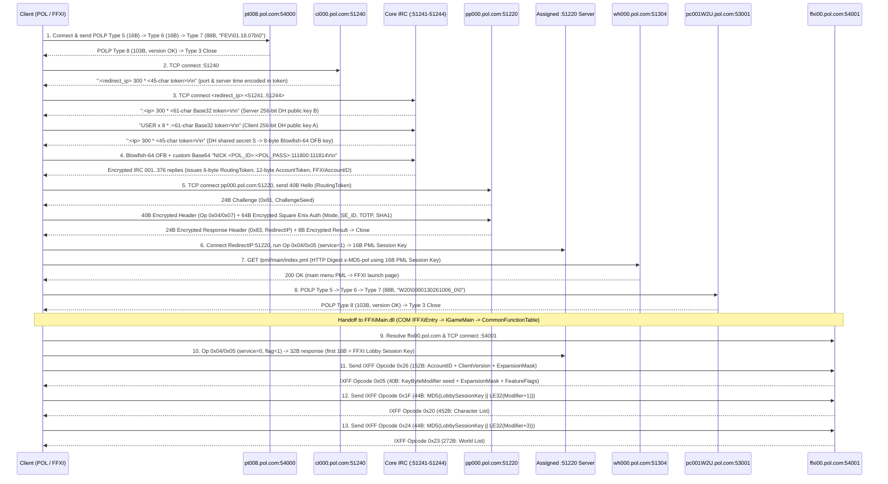

# Retail Login Protocol Specification

## 1. Header

- **Version**: 1.1.0 (Steady-State, First-Login, and Phase 2 TOTP Empirically Verified; Group 1 & 2 Protocol Parameters Inlined)
- **Date**: 2026-11-08
- **Provenance**: *Derived by an independent research process; no POL code was consulted by the implementer.*
- **Source**: In-house protocol observation and clean-room specification (`gordian-pol-research`).

---

## 2. Endpoints and Transport

Retail PlayOnline (`POL`) and Final Fantasy XI (`FFXI`) login uses **raw TCP sockets only** (no TLS/HTTPS is used at any stage, including Square Enix Account authentication).

| Stage | Host / Endpoint | Resolved IP (Observed) | Port (TCP) | Framing / Protocol | Purpose |
|---|---|---|---|---|---|
| 1 | `pt008.pol.com` | `124.150.156.107` | `54000` | `POLP` binary framing (16-byte BE header) | PlayOnline Viewer client version check (`"FEV\01.18.07b\0"`) |
| 2 | `ci000.pol.com` (`ci%03d.pol.com`) | `202.67.54.52` | `51240` | ASCII IRC line (`\r\n`) | Initial gatekeeper; returns `:<ip> 300 * <token>` redirecting to an active `:51241`–`:51244` session host |
| 3 | Redirected Core Session Host (`pol-1052-5124x.pol.com`) | `202.67.54.132` | `51241`–`51244` (`51242`, `51244` observed) | ASCII IRC (`300 *`, `USER`) $\rightarrow$ Blowfish-64 OFB + custom 6-bit Base64 IRC (`NICK`, `001`..`376`) | 256-bit Diffie-Hellman key exchange, POL ID (`8-char`) + POL Password (`16-char`) authentication, and session token issuance |
| 4 | `pp000.pol.com` (`pp%03d.pol.com`) | `202.67.54.51` | `51220` | 40-byte hello $\rightarrow$ 24-byte `0x81`/`0x83` challenge $\rightarrow$ Blowfish-64 OFB + 32-bit additive checksum | Square Enix Account authentication (`SE_ID`, `SE_PASS`, and optional 6-digit `TOTP` via Category `0x04` / Command `0x07`) and redirect to assigned `:51220` session server |
| 5 | Redirected Presence / Key Server | `202.67.54.159` | `51220` | 40-byte hello $\rightarrow$ 24-byte `0x81` challenge $\rightarrow$ Blowfish-64 OFB + 32-bit additive checksum | Account state queries (`0x04/0x06`, `0x04/0x03`, `0x05/0x09`) and per-service 16-byte Session Key issuance (`0x04/0x05`, used for both PML HTTP auth and the FFXI Lobby Session Key) |
| 6 | `wh000.pol.com` | `202.67.54.55` | `51304` (`51300`–`51307`) | HTTP/1.1 (`x-MD5-pol` Digest + `X-PlayOnline-Hello`) | PlayOnline PML navigation (`/pml/main/index.pml` $\rightarrow$ `/pml/game/ff11/index.pml`) |
| 7 | `pc001W2U.pol.com` | `124.150.156.107` | `53001` | `POLP` binary framing (16-byte BE header) | Final Fantasy XI pre-launch version check (`"W20\0000130261006_0\0"`) |
| 8 | `ffxi00.pol.com` | `124.150.154.122` | `54001` | 28-byte `IXFF` LE header + 16-byte MD5 packet digest | Final Fantasy XI Lobby server (Opcodes `0x26` $\rightarrow$ `0x05`, `0x1F` $\rightarrow$ `0x20`, `0x24` $\rightarrow$ `0x23`, `0x07` $\rightarrow$ `0x0B`) |

---

## 3. Session Flow



---

## 4. Message Field Tables

### 4.1 Version Check Framing (`POLP` on `pt008.pol.com:54000` and `pc001W2U.pol.com:53001`)

Used unauthenticated over plain TCP on `pt008.pol.com:54000` (PlayOnline Viewer check) and `pc001W2U.pol.com:53001` (Final Fantasy XI pre-launch check).

#### 4.1.1 Common `POLP` Frame Header (16 bytes / `0x10` bytes)
| Offset | Size | Type | Endianness | Field Name | Description |
|---|---|---|---|---|---|
| `+0x00` | 4 | `u32` | LE | `PacketSize` | Total packet length in bytes, including this 16-byte header (`0x00000058` = 88 on request; `0x00000067` = 103 on response). |
| `+0x04` | 4 | `u32` | LE | `Checksum` | 32-bit CRC checksum computed over payload bytes. |
| `+0x08` | 4 | `char[4]` | ASCII | `Magic` | Fixed ASCII string `"POLP"` (`50 4F 4C 50`). |
| `+0x0C` | 4 | `u32` | LE | `PacketType` | `0x00000007` = Client Version Request (88 bytes total); `0x00000008` = Server Version Response (103 bytes total). |

#### 4.1.2 `POLP` Type `7` — Client Version Request (88 bytes total: 16B header + 72B payload)
| Offset | Size | Type | Endianness | Field Name | Description |
|---|---|---|---|---|---|
| `+0x00` | 16 | `Header` | LE | `Header` | `PacketSize = 0x00000058` (88), `Checksum`, `Magic = "POLP"`, `PacketType = 0x00000007`. |
| `+0x10` | 4 | `char[4]` | ASCII | `ProductCode` | `"W2U\0"` (`57 32 55 00`) for POL Viewer (`:54000`); `"W20\0"` (`57 32 30 00`) for FFXI US Windows (`:53001`). |
| `+0x14` | 68 | `char[68]` | ASCII | `VersionString` | Null-terminated ASCII version string, zero-padded to 68 bytes: `"100020110829_E"` on `:54000`; `"000130261006_0"` on `:53001`. |

#### 4.1.3 `POLP` Type `8` — Server Version Response (103 bytes total: 16B header + 87B payload)
| Offset | Size | Type | Endianness | Field Name | Description |
|---|---|---|---|---|---|
| `+0x00` | 16 | `Header` | LE | `Header` | `PacketSize = 0x00000067` (103), `Checksum`, `Magic = "POLP"`, `PacketType = 0x00000008`. |
| `+0x10` | 4 | `u32` | LE | `NonceEcho` | Client/session tracking nonce echoed by server. |
| `+0x14` | 4 | `u32` | LE | `Status` | `0x00000001` = Registered / Up-to-date; non-zero if patch required. |
| `+0x18` | 11 | `char[11]` | ASCII | `StatusString` | Null-terminated ASCII status string (`"registered\0"`). |
| `+0x23` | 16 | `char[16]` | ASCII | `ServerIP` | Null-terminated ASCII server IP address (`"124.150.156.107\0"`). |
| `+0x33` | 2 | `char[2]` | ASCII | `Flag` | `"0\0"`. |
| `+0x35` | 35 | `u8[35]` | Raw | `Padding` | Zero bytes (`0x00` $\times 35$). |
| `+0x58` | 4 | `u32` | LE | `VersionLength` | `0x0000000B` (11 bytes). |
| `+0x5C` | 11 | `char[11]` | ASCII | `CurrentVersion` | Null-terminated ASCII current version: `"20110829_E\0"` on `:54000`; `"30261006_0\0"` on `:53001`. |

---

### 4.2 PlayOnline Core Gatekeeper & IRC/DH Session (`ci000.pol.com:51240` $\rightarrow$ `:51241`–`:51244`)

#### 4.2.1 Gatekeeper Redirect (`ci000.pol.com:51240` Server $\rightarrow$ Client)
Upon TCP connection to `ci000.pol.com:51240`, the server immediately sends a single CRLF-terminated ASCII line and closes the connection:
```text
:<redirect_ipv4> 300 * <45-char-token>\r\n
```
- `<redirect_ipv4>`: Dotted-quad IPv4 address of the assigned Core IRC session server (e.g., `202.67.54.132`).
- `<45-char-token>`:
  - Characters `0..40` (41 chars): PlayOnline 5-bit Base32 (`'0'..'5'` = `0..5`, `'A'..'Z'` = `6..31`) encoding 24 bytes (`0x18` bytes):
    - Bytes `0..3` (`u32_le`): Server Unix epoch timestamp $t_{\text{server}}$ (in seconds).
    - Bytes `4..5` (`u16_le`): Assigned TCP destination port on `<redirect_ipv4>` (`51241`–`51244`).
    - Bytes `6..23`: Session parameters/flags.
  - Characters `41..44` (4 chars): 4-character session suffix echoed in the subsequent handshake (e.g., `pYme`).

#### 4.2.2 Core IRC Diffie-Hellman Handshake (`:51241`–`:51244`)
1. **Server DH Greeting (`Server -> Client`)**:
   Upon connecting to `<redirect_ipv4>:<assigned_port>`, the server sends:
   ```text
   :<server_ipv4> 300 * <61-char-token>\r\n
   ```
   - Characters `0..56` (57 chars) of `<61-char-token>` decode via the PlayOnline 5-bit Base32 alphabet (`'0'..'5'` = `0..5`, `'A'..'Z'` = `6..31`, 5 bits per character, MSB-first bit stream) into 35 bytes (`0x23` bytes):
     - Byte `+0x00` (`u8`): Key exchange mode flag (`0x02` = 256-bit Diffie-Hellman).
     - Bytes `+0x01..+0x20` (`u8[32]`, big-endian): Server 256-bit Diffie-Hellman public value $B = g^b \bmod p$.
     - Bytes `+0x21..+0x22` (`u16`): 2-byte trailer.
   - Characters `57..60` (4 chars): 4-character session tag (e.g., `pYme`).

2. **Client DH Response (`Client -> Server`)**:
   The client generates a 256-bit private exponent $a$, computes its 32-byte big-endian public value $A = g^a \bmod p$ and 32-byte big-endian shared secret $S = B^a \bmod p$, encodes `[0x02] || A[0..31] || [0x00, 0x00]` (35 bytes) into 57 characters of PlayOnline 5-bit Base32, appends the 4-character session tag, and sends:
   ```text
   USER x 8 * :<57-char-base32-client-pub><4-char-tag>\r\n
   ```

3. **Server DH Confirmation (`Server -> Client`)**:
   The server replies with a 45-character `300 *` line confirming key establishment:
   ```text
   :<server_ipv4> 300 * <45-char-token>\r\n
   ```
   All subsequent IRC lines on this socket are transmitted directly on the wire encrypted with **Blowfish-64 OFB** (`reset_iv = 1` for each line), preserving `\r\n` (`0x0D 0x0A`) via the stream cipher's CRLF preservation rule (Section 5.1).

4. **Encrypted `NICK` Authentication (`Client -> Server`)**:
   The client formats the plaintext ASCII string:
   ```text
   NICK <Encoded_POL_ID>:<MD5_Hex_POL_PASS>:<Encoded_ClientMeta>\r\n
   ```
   - `<Encoded_POL_ID>`: 9-character PlayOnline 5-bit Base32 string encoding the 8-character POL ID.
   - `<MD5_Hex_POL_PASS>`: 32-character lowercase hexadecimal MD5 digest of the ASCII POL Password (`MD5(POL_PASS)`).
   - `<Encoded_ClientMeta>`: PlayOnline 5-bit Base32 string encoding client session parameters.
   The client encrypts this entire string with Blowfish-64 OFB (`reset_iv = 1`) and sends the resulting 86-byte ciphertext frame on the wire (ending in plaintext `\r\n`).

5. **Encrypted Server Welcome (`001`..`422`, `Server -> Client`)**:
   The server replies with IRC lines encrypted directly with Blowfish-64 OFB (`reset_iv = 1` per line). When decrypted, these yield standard numeric IRC lines:
   ```text
   :<server_ipv4> 300 * <token>\r\n
   :<server_ipv4> 001 <5-bit-Base32-Session-Payload>\r\n
   :<server_ipv4> 422 <POL_ID> :<tag>\r\n
   :<POL_ID> MODE <POL_ID> :+iLiv\r\n
   ```
   - Decrypted reply `001` contains the 5-bit Base32 session payload encoding:
     - 6-byte `RoutingToken` (`s=`, e.g., `F2 75 10 D5 9F 4C`)
     - 12-byte `AccountToken` (`a=`)
     - 8-byte `SessionSecret` (`k=`)
     - 32-bit `FFXIAccountID` (`u32_le`) consumed by `FFXiMain.dll` at `CommonFunctionTable + 0xEEC`.

---

### 4.3 Presence & Square Enix Account Server (`pp000.pol.com:51220` and Redirected `:51220`)

Every TCP connection to a `:51220` server performs a 4-frame exchange over a single socket:
1. **Client Plaintext Hello** (40 bytes)
2. **Server Plaintext Challenge Greeting** (24 bytes)
3. **Client Encrypted Request Header** (40 bytes, `reset_iv = 1`) + **Client Encrypted Request Payload** (`N` bytes, `reset_iv = 0`)
4. **Server Encrypted Response Header** (24 bytes, `reset_iv = 1`) + **Server Encrypted Response Payload** (`M` bytes, `reset_iv = 0`)

Both `pp000.pol.com:51220` and the redirected `:51220` server reuse the **exact same Blowfish-64 OFB key schedule and IV (`52 7E 58 C7 D4 C3 9A 32`) negotiated during the Stage 3 Diffie-Hellman key exchange**.

#### 4.3.1 Frame 1 — Client Connection Hello (40 bytes / `0x28` bytes, Plaintext)
| Offset | Size | Type | Endianness | Field Name | Description |
|---|---|---|---|---|---|
| `+0x00` | 4 | `u32` | BE | `Reserved0` | `0x00000000`. |
| `+0x04` | 2 | `u16` | BE | `ProtocolVersion` | `0x0100`. |
| `+0x06` | 6 | `u8[6]` | Raw | `RoutingToken` | 6-byte session routing token `s=` from Core IRC `001` (e.g., `F2 75 10 D5 9F 4C`). |
| `+0x0C` | 12 | `u8[12]` | Raw | `EncryptedAccountEcho` | Zeroes (`0x00` $\times 12$) on the initial connection to `pp000.pol.com:51220`; on subsequent connections to the redirected `:51220` server, set to bytes `+0x0C..+0x17` of the encrypted header (`59 9F 13 75 92 AD A7 F1 C1 A2 D5 5B`). |
| `+0x18` | 16 | `u8[16]` | Raw | `Padding` | Zeroes (`0x00`). |

#### 4.3.2 Frame 2 — Server Challenge Greeting (24 bytes / `0x18` bytes, Plaintext)
| Offset | Size | Type | Endianness | Field Name | Description |
|---|---|---|---|---|---|
| `+0x00` | 1 | `u8` | — | `GreetingType` | `0x81`. |
| `+0x01` | 19 | `u8[19]` | — | `Reserved` | Zeroes (`0x00` $\times 19$). |
| `+0x14` | 4 | `u32` | LE | `ChallengeSeed` | 32-bit server challenge nonce $C_{\text{seed}}$ (e.g., `0x6AF0F350`). |

#### 4.3.3 Frame 3a — Client Request Header (40 bytes / `0x28` bytes, Encrypted with `reset_iv = 1`)
Before encrypting all 40 bytes with the session's Diffie-Hellman Blowfish-64 OFB cipher (`reset_iv = 1`, OFB stream bytes `0..39`), the plaintext 40-byte request header has the layout:

| Offset | Size | Type | Endianness | Field Name | Description |
|---|---|---|---|---|---|
| `+0x00` | 1 | `u8` | — | `FrameType` | Fixed value `0x02`. |
| `+0x01` | 1 | `u8` | — | `ServiceCategory` | `0x04` for authentication and session key operations (`0x00`, `0x05`, `0x06`, `0x07` for presence/friends). |
| `+0x02` | 1 | `u8` | — | `Command` | `0x07` = Square Enix Account Auth (`64B` payload); `0x05` = Request 16-Byte Session Key (`40B` payload); `0x06` = Session Status (`8B` payload); `0x03` = Account Info (`416B` payload). |
| `+0x03` | 1 | `u8` | — | `Reserved0` | `0x00`. |
| `+0x04` | 4 | `u32` | LE | `PayloadLength` | Byte length of the encrypted payload frame following this header (`0x00000040` = 64, `0x00000028` = 40, `0x000001A0` = 416, etc.). |
| `+0x08` | 4 | `u32` | LE | `Reserved1` | `0x00000000`. |
| `+0x0C` | 12 | `u8[12]` | Raw | `AccountToken` | 12-byte `AccountToken` from Core IRC `001`. |
| `+0x18` | 16 | `u8[16]` | Raw | `ChallengeMD5` | 16-byte MD5 digest: `MD5(SessionSecret[8] || AccountToken[12] || LE32(ChallengeSeed)[4])`. |

#### 4.3.4 Frame 3b — Client Request Payload: Category `0x04` / Command `0x07` — Square Enix Account Auth (64 bytes / `0x40` bytes, Encrypted with `reset_iv = 0`)
Sent on `pp000.pol.com:51220` in Core Login State `28` (`0x1C`) immediately after the 40-byte Request Header, encrypted with `reset_iv = 0` (OFB stream bytes `40..103`):

| Offset | Size | Type | Endianness | Field Name | Description |
|---|---|---|---|---|---|
| `+0x00` | 1 | `u8` | — | `AuthMode` | `0x00` = No Square Enix Account; `0x01` = Square Enix ID + Password only (no OTP); `0x02` = Square Enix ID + Password + 6-digit One-Time Password (`TOTP`). |
| `+0x01` | 17 | `char[17]` | ASCII | `SquareEnixID` | Null-terminated ASCII Square Enix ID (up to 16 characters, zero-padded). |
| `+0x12` | 14 | `char[14]` | ASCII | `OneTimePassword` | When `AuthMode == 0x02`: 6-digit ASCII One-Time Password at `+0x12..+0x17` followed by zero padding (`+0x18..+0x1F`). When `AuthMode == 0x01`: all 14 bytes are `0x00`. |
| `+0x20` | 20 | `u8[20]` | Raw | `PasswordTimeDigest` | 20-byte raw SHA-1 digest of the time-bound Square Enix Password hash (see Section 5.4). |
| `+0x34` | 8 | `u8[8]` | — | `Reserved` | Zeroes (`0x00`). |
| `+0x3C` | 4 | `u32` | LE | `Checksum` | 32-bit PlayOnline additive checksum (Section 5.3) computed over plaintext bytes `+0x00..+0x3B`. |

#### 4.3.5 Frame 3b — Client Request Payload: Category `0x04` / Command `0x05` — Session Key Exchange (40 bytes / `0x28` bytes, Encrypted with `reset_iv = 0`)
Used twice during steady-state login on the assigned `:51220` server:
1. Prior to PML HTTP requests (`service_type = 1`, `param = 1000`) to obtain the 16-byte PML Session Key.
2. In `FFXiMain.dll` Lobby State `11` (`service_type = 0`, `param = 1`) to obtain the **16-byte FFXI Lobby Session Key**.

| Offset | Size | Type | Endianness | Field Name | Description |
|---|---|---|---|---|---|
| `+0x00` | 36 | `u8[36]` | BE | `KeyRequestParams` | Service key exchange parameters (`ServiceType`: `1` for PML HTTP, `0` for FFXI Lobby; `Flags`: `1000` for PML, `1` for FFXI Lobby; plus client session identifiers). |
| `+0x24` | 4 | `u32` | LE | `Checksum` | 32-bit PlayOnline additive checksum (Section 5.3) over plaintext bytes `+0x00..+0x23`. |

#### 4.3.6 Frame 4a — Server Response Header (24 bytes / `0x18` bytes, Decrypted with `reset_iv = 1`)
Decrypted with the session's Diffie-Hellman Blowfish-64 OFB cipher (`reset_iv = 1`, OFB stream bytes `0..23`):

| Offset | Size | Type | Endianness | Field Name | Description |
|---|---|---|---|---|---|
| `+0x00` | 1 | `u8` | — | `ResponseType` | `0x83`. |
| `+0x01` | 1 | `u8` | — | `Status` | `0x00` = Success; non-zero = error code. |
| `+0x02` | 2 | `u16` | — | `Reserved0` | `0x0000`. |
| `+0x04` | 4 | `u32` | LE | `PayloadLength` | Byte length of the encrypted response payload following this 24-byte header (`0x00000020` = 32 for `0x04/0x05`, `0x00000008` = 8 for `0x04/0x07`), or on initial `pp000.pol.com:51220` redirect, the assigned `:51220` session server IPv4 address (`202.67.54.159`). |
| `+0x08` | 4 | `u32` | LE | `Reserved1` | Server sequence / status word. |
| `+0x0C` | 12 | `u8[12]` | Raw | `AccountToken` | Echo of the 12-byte `AccountToken`. |

#### 4.3.7 Frame 4b — Server Response Payload: Category `0x04` / Command `0x05` (32 bytes / `0x20` bytes, Decrypted with `reset_iv = 0`)
Decrypted with `reset_iv = 0` (OFB stream bytes `24..55`):

| Offset | Size | Type | Endianness | Field Name | Description |
|---|---|---|---|---|---|
| `+0x00` | 16 | `u8[16]` | Raw | `SessionKey` | **16-byte Session Key** (stored by `polcore.dll` and returned to `FFXiMain.dll` via `CommonFunctionTable + 0xFAC`). |
| `+0x10` | 12 | `u8[12]` | Raw | `ZeroPadding` | 12 zero bytes (`0x00` $\times 12$). |
| `+0x1C` | 4 | `u32` | LE | `Checksum` | 32-bit PlayOnline additive checksum over plaintext bytes `+0x00..+0x1B`. |

---

### 4.4 PlayOnline PML HTTP Protocol (`wh000.pol.com:51304`)

PML navigation uses HTTP/1.1 over plain TCP port `51304` with HTTP Digest authentication (`algorithm=x-MD5-pol`).

| Header Name | Direction | Format / Value |
|---|---|---|
| `User-Agent` | Client $\rightarrow$ Server | `PlayOnlineViewer/1.18.14 (Win)` |
| `Accept` | Client $\rightarrow$ Server | `text/x-playonline-pml;level=2, image/x-playonline-ang, image/png, image/jpeg, */*` |
| `X-PlayOnline-Agent` | Client $\rightarrow$ Server | `compatible; PlayOnlineViewer/1.0; Windows; I; US` |
| `X-PlayOnline-Service` | Client $\rightarrow$ Server | `pol:0; ff11:1; tetra:1; fmv:1; front:1` |
| `X-PlayOnline-Want-Hello` | Client $\rightarrow$ Server | `<8-hex-char-challenge>` (on initial `GET /pml/main/index.pml`) |
| `X-PlayOnline-Hello` | Server $\rightarrow$ Client | Base64-encoded 32-byte server signature over the `Want-Hello` challenge |
| `WWW-Authenticate` | Server $\rightarrow$ Client | `Digest realm="main@wh000.pol.com", nonce="<46-char-nonce>", opaque="<8-hex-char>", algorithm=x-MD5-pol, qop="auth"` |
| `Authorization` | Client $\rightarrow$ Server | `Digest username="<16-char-session-user>", realm="main@wh000.pol.com", nonce="<nonce>", uri="/pml/main/index.pml", cnonce="<8-hex>", nc=00000001, response="<32-hex-md5>", qop="auth", algorithm=x-MD5-pol, opaque="<opaque>"` |

- **Traffic Parity & Behavioral Telemetry (Recommended)**:
  To match genuine PlayOnline Viewer network behavior 1:1 and prevent backend telemetry detection (where Square Enix server logs could flag accounts skipping the PlayOnline Viewer web tier), the client SHOULD perform the standard PML navigation sequence:
  1. Request the 16-byte PML Session Key from the assigned `:51220` server via Op `0x04/0x05` (`service = 1`, `param = 1000`).
  2. Connect TCP `wh000.pol.com:51304`, send `GET /pml/main/index.pml`, handle the initial HTTP 401 Digest challenge using the PML Session Key, and receive the authenticated 200 OK.
  3. Send `GET /pml/game/ff11/index.pml?SC=0&PF=WIN` over the same keep-alive TCP socket (`Connection: Keep-Alive`).
  4. Discard the received PML response bodies without rendering.
  *Timing Impact*: In live network captures, this entire 2-request exchange over a single persistent TCP connection adds only **300–400 ms** total, incurring no meaningful delay while ensuring the network signature is identical to retail.

---

### 4.5 Final Fantasy XI Lobby Protocol (`ffxi00.pol.com:54001`)

> **LandSandBoat Compatibility Verification**: Both static disassembly of `FFXiMain.dll` (`0x10114000`–`0x10116400`) and live wire capture on `124.150.154.122:54001` confirm that the retail FFXI Lobby protocol uses the exact 28-byte (`0x1C`) `IXFF` header, MD5 packet integrity hashing, MD5 session key salting (`SessionHash`), and packet structures expected by LandSandBoat's `xi::lobby` server.

#### 4.5.1 Common Lobby Packet Header (28 bytes / `0x1C` bytes)
| Offset | Size | Type | Endianness | Field Name | Description |
|---|---|---|---|---|---|
| `+0x00` | 4 | `u32` | LE | `PacketSize` | Total packet length in bytes, including this 28-byte header (`0x1C` to `0xFC0`). |
| `+0x04` | 4 | `char[4]` | ASCII | `Magic` | Fixed ASCII string `"IXFF"` (`49 58 46 46`, or `0x46465849` as `u32_le`). |
| `+0x08` | 4 | `u32` | LE | `Command` | Lobby opcode (`0x26`, `0x05`, `0x1F`, `0x20`, `0x24`, `0x23`, `0x07`, `0x0B`, `0x14`, `0x21`, `0x22`). |
| `+0x0C` | 16 | `u8[16]` | Raw | `PacketMD5` | MD5 digest computed over the entire packet (`0 .. PacketSize - 1`) with header bytes `+0x0C .. +0x1B` set to `0x00` prior to hashing. |

#### 4.5.2 Client Opcode `0x26` — Login & Client Version Check (152 bytes / `0x98` bytes, Sent Once in State 14)
| Offset | Size | Type | Endianness | Field Name | Description |
|---|---|---|---|---|---|
| `+0x00` | 28 | `Header` | LE | `Header` | `PacketSize = 0x00000098` (152), `Magic = "IXFF"`, `Command = 0x00000026`, `PacketMD5`. |
| `+0x1C` | 16 | `u8[16]` | Raw | `UnusedHash` | Zeroes (`0x00` $\times 16$) on initial `0x26` send. |
| `+0x2C` | 4 | `u32` | LE | `ClientPlatform` | `0x00000005` (Windows retail client identifier). |
| `+0x30` | 4 | `u32` | LE | `Reserved0` | `0x00000000`. |
| `+0x34` | 4 | `u32` | LE | `FFXIAccountID` | 32-bit FFXI Content/Account ID (e.g., `27 1E 2E 08` = `0x082E1E27` = `137240103`). |
| `+0x38` | 60 | `u8[60]` | Raw | `ReservedToken` | 60 bytes of client session buffer (bytes `+0x34..+0x73` form the 64-byte `ReservedToken` block used later in `Opcode 0x07`). |
| `+0x74` | 15 | `char[15]` | ASCII | `ClientVersion` | Null-terminated ASCII client version string (`"30261006_0"`, zero-padded to 15 bytes). |
| `+0x83` | 1 | `u8` | — | `VersionTerm` | `0xFF`. |
| `+0x84` | 4 | `u32` | LE | `ExpansionMask` | Client installed expansion bitmask (`0x00000FFF`). |
| `+0x88` | 16 | `u8[16]` | — | `Padding` | Zeroes (`0x00` $\times 16$). |

#### 4.5.3 Server Opcode `0x05` — Login Version Ack & Modifier Seed (40 bytes / `0x28` bytes)
| Offset | Size | Type | Endianness | Field Name | Description |
|---|---|---|---|---|---|
| `+0x00` | 28 | `Header` | LE | `Header` | `PacketSize = 0x00000028` (40), `Magic = "IXFF"`, `Command = 0x00000005`, `PacketMD5`. |
| `+0x1C` | 4 | `u32` | LE | `ModifierSeed` | Initial 32-bit `KeyByteModifier` seed $M_0$ assigned by the Lobby server (e.g., `FA F1 0D 59` = `0x590DF1FA`). |
| `+0x20` | 4 | `u32` | LE | `ExpansionMask` | Enabled account expansion bitmask (e.g., `0x00000001` on trial account). |
| `+0x24` | 4 | `u32` | LE | `FeatureFlags` | Enabled account feature flags (e.g., `0x00000002`). |

#### 4.5.4 Client Opcode `0x1F` — Request Character List (44 bytes / `0x2C` bytes)
| Offset | Size | Type | Endianness | Field Name | Description |
|---|---|---|---|---|---|
| `+0x00` | 28 | `Header` | LE | `Header` | `PacketSize = 0x0000002C` (44), `Magic = "IXFF"`, `Command = 0x0000001F`, `PacketMD5`. |
| `+0x1C` | 16 | `u8[16]` | Raw | `SessionHash` | `MD5(SessionKey[16] || LE32(ModifierSeed + 1))` (see Section 5.5). |

#### 4.5.5 Server Opcode `0x20` — Character List Response (452 bytes / `0x1C4` bytes observed)
| Offset | Size | Type | Endianness | Field Name | Description |
|---|---|---|---|---|---|
| `+0x00` | 28 | `Header` | LE | `Header` | `PacketSize = 0x000001C4` (452), `Magic = "IXFF"`, `Command = 0x00000020`, `PacketMD5`. |
| `+0x1C` | 4 | `u32` | LE | `ContentIDCount` | Number of character/content slots returned (`0x00000003` observed; each slot is 140 / `0x8C` bytes starting at `+0x20`). |
| `+0x20` | `140 * N` | `Slot[N]` | LE | `CharacterSlots` | Array of 140-byte character slot records (`FFXIContentID` at `+0x00`, `CharacterID` at `+0x04`, `Status` at `+0x08`, `CharacterName[16]` at `+0x0C`, `CharInfo` structure at `+0x2C`). |

#### 4.5.6 Client Opcode `0x24` — Request World List (44 bytes / `0x2C` bytes)
| Offset | Size | Type | Endianness | Field Name | Description |
|---|---|---|---|---|---|
| `+0x00` | 28 | `Header` | LE | `Header` | `PacketSize = 0x0000002C` (44), `Magic = "IXFF"`, `Command = 0x00000024`, `PacketMD5`. |
| `+0x1C` | 16 | `u8[16]` | Raw | `SessionHash` | `MD5(SessionKey[16] || LE32(ModifierSeed + 3))` (incremented by `+2` after `0x1F`/`0x20`). |

#### 4.5.7 Server Opcode `0x23` — World List Response (272 bytes / `0x110` bytes observed)
| Offset | Size | Type | Endianness | Field Name | Description |
|---|---|---|---|---|---|
| `+0x00` | 28 | `Header` | LE | `Header` | `PacketSize = 0x00000110` (272), `Magic = "IXFF"`, `Command = 0x00000023`, `PacketMD5`. |
| `+0x1C` | 4 | `u32` | LE | `WorldCount` | Number of active worlds returned (e.g., `0x0000000C` = 12 worlds). |
| `+0x20` | `20 * N` | `World[N]` | LE | `WorldEntries` | Array of 20-byte (`0x14`) world records: `+0x00` = `u32_le WorldID`, `+0x04` = `char[16] WorldName` (null-terminated ASCII). |

#### 4.5.8 Client Opcode `0x07` — Select Character (88 bytes / `0x58` bytes)
| Offset | Size | Type | Endianness | Field Name | Description |
|---|---|---|---|---|---|
| `+0x00` | 28 | `Header` | LE | `Header` | `PacketSize = 0x00000058` (88), `Magic = "IXFF"`, `Command = 0x00000007`, `PacketMD5`. |
| `+0x1C` | 4 | `u32` | LE | `FFXIContentID` | Selected character's 32-bit FFXI Content ID. |
| `+0x20` | 4 | `u32` | LE | `CharacterID` | Selected character's 32-bit Character ID. |
| `+0x24` | 16 | `char[16]` | ASCII | `CharacterName` | Selected character's 15-byte null-terminated ASCII name. |
| `+0x34` | 16 | `u8[16]` | Raw | `SessionHash` | Salted MD5 of the 16-byte Lobby Session Key using the current `KeyByteModifier`. |
| `+0x44` | 4 | `u32` | LE | `Reserved` | `0x00000000`. |
| `+0x48` | 16 | `u8[16]` | Raw | `SelectionMD5` | Secondary MD5 digest computed over the 92-byte (`0x5C`) concatenation of: `ReservedToken[64]` (`Opcode 0x26` bytes `+0x34..+0x73`) $\|$ `SessionHash[16]` $\|$ `LE32(FFXIContentID)[4]` $\|$ `LE32(CharacterID)[4]` $\|$ `0x00000000[4]`. |

---

## 5. Cryptography

### 5.1 PlayOnline 256-Bit Diffie-Hellman & MD5-Expanded Blowfish-64 OFB Cipher (`:51241`–`:51244` and `:51220`)
Both the Core IRC session (`:51241`–`:51244`) and all Presence/Key server (`:51220`) connections in a login session share a single **Blowfish-64 Output Feedback (OFB)** cipher instance initialized from the Stage 3 Diffie-Hellman key exchange:

1. **256-Bit Diffie-Hellman Domain Parameters**:
   - **Prime Modulus $p$** (32-byte big-endian unsigned integer):
     ```text
     D5 B4 AA F9 E7 58 F0 C2 79 A5 F3 A0 21 E5 05 26
     2F 9F 2F C0 2B EC E0 42 5D B1 D0 04 B2 D3 34 F9
     ```
   - **Generator $g$**: `67` (`0x43`).
   - Given the server's 32-byte big-endian public value $B = g^b \bmod p$ and client private exponent $a$, compute the 32-byte big-endian shared secret $S = B^a \bmod p$ (`S[0..31]`, where `S[0]` is MSB and `S[31]` is LSB).
   - **64-Bit Key Extraction**: Take the last 8 bytes of $S$ in reverse order (`K8 = [S[31], S[30], S[29], S[28], S[27], S[26], S[25], S[24]]`) and form two 32-bit little-endian words:
     - `key_lo = u32_le(K8[0..3])`
     - `key_hi = u32_le(K8[4..7])`

2. **MD5 Key Expansion (64-bit input key $\rightarrow$ 320-bit Blowfish key)**:
   - Given `K8 = LE32(key_lo) || LE32(key_hi)`:
     - `Digest1 = MD5(K8)` (16 bytes $\rightarrow$ 4 little-endian 32-bit words `W[0..3]`).
     - `Digest2 = MD5(Digest1)` (16 bytes $\rightarrow$ 4 little-endian 32-bit words `W[4..7]`).
     - `W[8] = key_lo`, `W[9] = key_hi`.
   - Initialize the Blowfish $P$-array (`P[0..17]`) and four $S$-boxes (`S0..S3`) with the standard fractional-$\pi$ Blowfish constants, XOR `P[i]` with `W[i mod 10]` for $i \in [0, 17]$, and run the standard 16-round Blowfish key-schedule encryption pass over `P[0..17]` and `S0..S3` starting from `(0, 0)`.

3. **64-Bit Output Feedback (OFB) Mode & Initial IV**:
   - **Initial 8-byte IV**: `52 7E 58 C7 D4 C3 9A 32` (`iv_lo = 0xC7587E52`, `iv_hi = 0x329AC3D4`).
   - When `reset_iv != 0`, set `(cur_lo, cur_hi) = (iv_lo, iv_hi)` and `byte_offset = 0`.
   - For each byte $i$:
     1. When `byte_offset & 7 == 0`, advance the 64-bit feedback register using one 16-round Blowfish block encryption: `(cur_lo, cur_hi) = BlowfishEncrypt(cur_lo, cur_hi)`.
     2. Extract keystream byte `ks = ((byte_offset & 4) ? cur_hi : cur_lo) >> (8 * (byte_offset & 3)) & 0xFF` and increment `byte_offset`.
     3. Compute `out_byte = in_byte ^ ks`.
     4. **CRLF Preservation Rule**: If `in_byte == 0x0A` (`\n`), `in_byte == 0x0D` (`\r`), `out_byte == 0x0A`, or `out_byte == 0x0D`, write `in_byte` unchanged (`out_byte = in_byte`); otherwise write `out_byte`.

### 5.2 PlayOnline Custom 6-Bit Base64 (`:51241`–`:51244` Encrypted IRC Lines)
Encrypted IRC payloads prefixed with `$` map 6-bit values (`0..63`) to ASCII characters via:
- `0..9` $\rightarrow$ `'0'..'9'` (`0x30..0x39`)
- `10..35` $\rightarrow$ `'A'..'Z'` (`0x41..0x5A`)
- `36` $\rightarrow$ `'-'` (`0x2D`)
- `37..62` $\rightarrow$ `'a'..'z'` (`0x61..0x7A`)
- `63` $\rightarrow$ `'_'` (`0x5F`)

Every 3 bytes (`b0, b1, b2`) are packed LSB-first (`b0 | (b1 << 8) | (b2 << 16)`) and emitted as up to 4 characters (`val & 0x3F`, `(val >> 6) & 0x3F`, `(val >> 12) & 0x3F`, `(val >> 18) & 0x3F`).

### 5.3 PlayOnline 32-Bit Additive Checksum (`:51220` Payloads)
Every `:51220` payload ends with a 4-byte little-endian checksum over the preceding $N - 4$ plaintext bytes (`len = N - 4`):
1. Sum all 32-bit little-endian words `u32_le` in `buf[0 .. (len & ~3) - 1]` into a 32-bit accumulator `acc`.
2. If `len & 3` is non-zero, fold the remaining $1..3$ bytes into a zero-padded little-endian word and add to `acc`.
3. Write `LE32(acc)` into the final 4 bytes (`buf[N - 4 .. N - 1]`).

### 5.4 Square Enix Account Password Time-Bound SHA-1 Digest (`:51220` Op `0x04/0x07`)
In `:51220` Category `0x04` / Command `0x07` (64-byte payload), bytes `+0x20..+0x33` contain a 20-byte raw SHA-1 digest computed as follows:
1. Compute the 20-byte raw SHA-1 digest of the ASCII Square Enix Password:
   $$H_1 = \text{SHA-1}(\text{ASCII}(\text{SE\_PASS}))$$
2. Format $H_1$ as a **40-character lowercase hexadecimal ASCII string** (`"%02x"` for each of the 20 bytes).
3. Take the current server Unix timestamp $t_{\text{server}}$ (initialized from the `:51240`/`:51242` `300 *` greeting timestamp and incremented by elapsed local seconds), round it down to the nearest 60-second minute boundary, and format it as a decimal ASCII string:
   $$T_{\text{str}} = \text{sprintf}\!\left(\text{"\%d"},\; \lfloor t_{\text{server}} / 60 \rfloor \times 60\right)$$
4. Concatenate the 40-character lowercase hex string and the decimal timestamp string (50 ASCII bytes total for 10-digit Unix timestamps) and compute the raw 20-byte SHA-1 digest:
   $$\text{PasswordTimeDigest}_{20} = \text{SHA-1}\!\left(\text{LowercaseHex}_{40}(H_1) \;\|\; T_{\text{str}}\right)$$

### 5.5 FFXI Lobby Packet MD5 & `SessionHash` Salting (`:54001`)
1. **Lobby Packet Integrity Hash (`PacketMD5` at `+0x0C..+0x1B`)**:
   - Set bytes `+0x0C..+0x1B` of the `IXFF` packet to `0x00`.
   - Compute `MD5(packet[0 .. PacketSize - 1])` (RFC 1321) and write the 16-byte digest into `+0x0C..+0x1B`.
2. **Lobby `SessionHash` (`Opcode 0x1F`, `0x24`, `0x07`)**:
   - Given the 16-byte `LobbySessionKey` (from `:51220` Op `0x04/0x05`) and the 32-bit `ModifierSeed` $M_0$ (from `Opcode 0x05` offset `+0x1C`):
   - For `Opcode 0x1F` (Request Character List): `Modifier = M_0 + 1`.
   - For `Opcode 0x24` (Request World List): `Modifier = M_0 + 3`.
   - Form the 20-byte buffer `B = LobbySessionKey[0..15] || LE32(Modifier)` and compute `SessionHash = MD5(B)`.

---

## 6. Authentication

### 6.1 Credential Inputs
| Credential | Length / Format | Where Consumed |
|---|---|---|
| `POL_ID` | 8 ASCII characters (`ABCD1234`) | Sent in Stage 3 (`:51241`–`:51244`) encrypted `NICK <POL_ID>:<POL_PASS>:111800:111814` |
| `POL_PASS` | Up to 16 ASCII characters | Sent in Stage 3 (`:51241`–`:51244`) encrypted `NICK` command |
| `SE_ID` | Up to 16 ASCII characters | Sent in Stage 4 (`pp000.pol.com:51220` Op `0x04/0x07`) at payload offset `+0x01..+0x11` |
| `SE_PASS` | ASCII string | Hashed via `SHA-1` $\rightarrow$ 40-char lowercase hex $\rightarrow$ time-bound `SHA-1` at payload offset `+0x20..+0x33` of `:51220` Op `0x04/0x07` |
| `TOTP` (Optional) | 6 ASCII digits (`"000000"`–`"999999"`) | Sent in Stage 4 (`pp000.pol.com:51220` Op `0x04/0x07`) at payload offset `+0x12..+0x17` when `AuthMode` (`+0x00`) is `0x02` |

### 6.2 Phase 1 (No OTP) vs. Phase 2 (Software Token / TOTP)
Both flows use the **exact same 64-byte `:51220` Category `0x04` / Command `0x07` packet**, empirically verified across live captures:
- **Phase 1 (SE ID + SE Password only)** — *Verified in Capture #2*:
  - `payload[0x00] = 0x01` (`AuthMode = 1`)
  - `payload[0x01..0x11]` = Null-terminated `SE_ID` (up to 16 characters, zero-padded)
  - `payload[0x12..0x1F]` = All zeroes (`0x00` $\times 14$)
  - `payload[0x20..0x33]` = 20-byte `PasswordTimeDigest`
  - `payload[0x34..0x3B]` = All zeroes (`0x00` $\times 8$)
  - `payload[0x3C..0x3F]` = 32-bit additive checksum over `payload[0x00..0x3B]`
- **Phase 2 (SE ID + SE Password + 6-digit TOTP / Google Authenticator)** — *Verified in Capture #3*:
  - `payload[0x00] = 0x02` (`AuthMode = 2`)
  - `payload[0x01..0x11]` = Null-terminated `SE_ID` (up to 16 characters, zero-padded)
  - `payload[0x12..0x17]` = 6 ASCII digits of the One-Time Password (`TOTP`, e.g., `"300246"`), followed by zero padding at `0x18..0x1F` (`0x00` $\times 8$)
  - `payload[0x20..0x33]` = 20-byte `PasswordTimeDigest`
  - `payload[0x34..0x3B]` = All zeroes (`0x00` $\times 8$)
  - `payload[0x3C..0x3F]` = 32-bit additive checksum over `payload[0x00..0x3B]`

---

## 7. States and Errors

### 7.1 PlayOnline Core Login State Machine (Observed Steady-State Trajectory)
| State | Action | Next State |
|---|---|---|
| `0` $\rightarrow$ `17` $\rightarrow$ `30` | Pre-login initialization and `pt008.pol.com:54000` (`POLP` Type `5`/`6`/`7`/`8`) Viewer version check. | $\rightarrow 18$ |
| `18` $\rightarrow$ `19` | Resolve `ci000.pol.com` and connect TCP `:51240` to receive redirect IP, port (`51241`–`51244`), and server timestamp $t_{\text{server}}$. | $\rightarrow 21$ |
| `21` $\rightarrow$ `22` | Connect to redirected `:51241`–`:51244` server, exchange 256-bit Diffie-Hellman `300 *` / `USER x 8 *`, and initialize Blowfish-64 OFB. | $\rightarrow 23$ |
| `23` | Send encrypted `NICK <POL_ID>:<POL_PASS>:111800:111814` and parse `001`..`376` (`RoutingToken`, `AccountToken`, `SessionSecret`, `FFXIAccountID`). | $\rightarrow 24$ |
| `24` $\rightarrow$ `26` $\rightarrow$ `27` | Resolve `pp000.pol.com` and connect TCP `:51220`; send 40-byte Hello and receive 24-byte `0x81` challenge (`ChallengeSeed`). | $\rightarrow 28$ |
| `28` $\rightarrow$ `29` $\rightarrow$ `30` | Build and send 40-byte encrypted Request Header + 64-byte Square Enix Account authentication payload (`Op 0x04/0x07`) and receive 24-byte `0x83` response header (with redirected `:51220` server IP) + 8-byte result. | Complete |

### 7.2 FFXI Lobby Client State Machine (`FFXiMain.dll`, Observed Steady-State Trajectory)
| State | Action | Next State |
|---|---|---|
| `0` $\rightarrow$ `1` | Resolve `"ffxi00.pol.com"` via `CommonFunctionTable + 0x374` / `+0x378` (`124.150.154.122`). | $\rightarrow 2$ |
| `2` $\rightarrow$ `10` | Allocate Lobby context and connect TCP socket to `124.150.154.122:54001`. | $\rightarrow 11$ |
| `11` $\rightarrow$ `12` | Invoke `CommonFunctionTable + 0x30C` (`(-2, -1, 0, -2, -1, 1)`) and poll `+0x310` until `:51220` `Op 0x04/0x05` returns the 16-byte Lobby Session Key. | $\rightarrow 13$ |
| `13` $\rightarrow$ `14` | Read 32-bit `FFXIAccountID` via `+0xEEC` and 16-byte `LobbySessionKey` via `+0xFAC`; send 152-byte `Opcode 0x26`. | $\rightarrow 15$ |
| `15` $\rightarrow$ `16` | Receive 40-byte `Opcode 0x05` (extract `ModifierSeed`, `ExpansionMask`, `FeatureFlags`); compute `SessionHash(ModifierSeed + 1)` and send 44-byte `Opcode 0x1F`. | $\rightarrow 17$ |
| `17` $\rightarrow$ `18` | Receive 452-byte `Opcode 0x20` (Character List); compute `SessionHash(ModifierSeed + 3)` and send 44-byte `Opcode 0x24` (Request World List). | $\rightarrow 19$ |
| `19` $\rightarrow$ `21` | Receive 272-byte `Opcode 0x23` (World List) and enter interactive Character Selection screen. | UI Ready |

---

## 8. Handoff (`pol.exe` / `polcore.dll` $\rightarrow$ `FFXi.dll` / `FFXiMain.dll`)

### 8.1 COM Activation Sequence
1. `pol.exe` instantiates `CLSID_POLCoreCom` (`{3501F5DD-7894-42DF-866A-A2B6527D8049}`, `IID_IPOLCoreCom` `{E0516654-EF77-435D-AA7D-50D2C069CE34}`).
2. When launching Final Fantasy XI, `app.dll` instantiates `CLSID_FFXiEntry` (`{989D790D-6236-11D4-80E9-00105A81E890}`, `IID_IFFXiEntry` `{989D790C-6236-11D4-80E9-00105A81E890}`) in `FFXi.dll` and invokes `IFFXiEntry::GameStart(pPol, pFFXiMessage)`.
3. `FFXi.dll` instantiates `CLSID_GameMain` (`{1027DC46-750D-4B1F-8834-1D25B8BEBAB8}`, `IID_IGameMain` `{493BF7B9-0C3A-43B5-BFA6-28FBEE251E3D}`) in `FFXiMain.dll` and invokes `IGameMain::FFXiGameMain(pPol, pFFXi)`.
4. `FFXiMain.dll` calls `IPOLCoreCom::GetCommonFunctionTable(&pTable)` (vtable index 7) to obtain a pointer to `polcore.dll`'s `CommonFunctionTable`.

### 8.2 `CommonFunctionTable` Handoff Contract Consumed by `FFXiMain.dll`
| Table Byte Offset | Index (`offset / 4`) | Signature | Purpose in Handoff |
|---|---|---|---|
| `+0x30C` | `195` | `int StartKeyExchange(int a0, int a1, int service, int a3, int a4, int param)` | Initiates `:51220` `Op 0x04/0x05` session key exchange (`(-2, -1, 0, -2, -1, 1)`). |
| `+0x310` | `196` | `int PollKeyExchange(int handle)` | Polls `:51220` `Op 0x04/0x05` completion (`1` = complete) and stores the 16-byte Lobby Session Key. |
| `+0x374` | `221` | `int StartDnsLookup(const char* hostname)` | Initiates async DNS lookup for `"ffxi00.pol.com"`. |
| `+0x378` | `222` | `int PollDnsLookup(int handle, void* outAddr)` | Polls async DNS resolution and writes resolved IPv4 address. |
| `+0xEEC` | `955` | `int GetFFXIAccountID(uint32_t* outAccountId)` | Writes the authenticated 32-bit FFXI Content/Account ID into `*outAccountId`. |
| `+0xFAC` | `1003` | `int GetLobbySessionKey(uint8_t outKey[16])` | Copies the 16-byte Lobby Session Key into `outKey[0..15]`. |

---

## 9. Open Questions and Operational Notes

1. **Legacy Hardware Security Token vs. Software Token**:
   - `AuthMode = 0x02` has been empirically verified with a registered Software Authenticator (Google Authenticator) transmitting 6 ASCII digits at payload offset `+0x12..+0x17`.
   - Legacy physical hardware security tokens (Square Enix Digipass) also generate 6-digit OTP codes and are expected to use the exact same `AuthMode = 0x02` frame layout. If a user utilizes a legacy hardware token, the implementation passes the 6 digits in the identical field.

2. **Specific Error Code Enumeration on Failed Authentication**:
   - Live captures all exercised valid credentials resulting in `Status == 0x00`.
   - Any non-zero `Status` byte returned in the 24-byte response header on `pp000.pol.com:51220` (Frame 4a offset `+0x01`), or non-zero IRC numeric errors (`4xx`/`5xx`) on `:51240`, should be surfaced by the client as an authentication failure.

3. **Retail Version Check Discrepancy Action**:
   - On `pt008.pol.com:54000` and `pc001W2U.pol.com:53001`, `POLP` Type 8 returned `Status = 0x00000001` ("registered").
   - If the local client version does not match retail, the server returns a non-zero status code indicating that client files are outdated. As confirmed by user policy, GordianXI should check its version on disk against retail before permitting login; if retail is newer, the launcher should direct the user to update in PlayOnline Viewer or offer an optional admin-launched updater process rather than attempting to download patch files directly in the login flow.

4. **Credential Cache Excluded**:
   - The proprietary PlayOnline local encrypted credential file (`login_w.bin`) has been intentionally excluded from the specification. The implementer must manage user credentials directly within GordianXI's own secure account management rather than interacting with `login_w.bin`.
