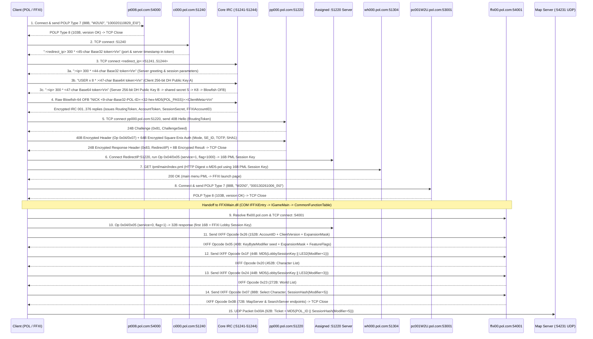

# Retail Login Protocol Specification

## 1. Header

- **Version**: 1.7.0 (Diffie-Hellman Stage 3 Full Endianness & Wire Exchange Reconciled, Map 0x00A Ticket & 92-Byte Framing Harmonized, Test Vectors 8–10 Complete & Verified)
- **Date**: 2026-11-09
- **Provenance**: *Derived by an independent research process; no POL code was consulted by the implementer.*
- **Source**: In-house protocol observation and clean-room specification (`gordian-pol-research`).

---

## 2. Endpoints and Transport

Retail PlayOnline (`POL`) and Final Fantasy XI (`FFXI`) login uses **raw TCP sockets only** (no TLS/HTTPS is used at any stage, including Square Enix Account authentication).

| Stage | Host / Endpoint | Resolved IP (Observed) | Port (TCP) | Framing / Protocol | Purpose |
|---|---|---|---|---|---|
| 1 | `pt008.pol.com` | `124.150.156.107` | `54000` | `POLP` binary framing (16-byte BE header) | PlayOnline Viewer client version check (`ProductCode = "W2U\0"`, `VersionString = "100020110829_E\0"`) |
| 2 | `ci000.pol.com` (`ci%03d.pol.com`) | `202.67.54.52` | `51240` | ASCII IRC line (`\r\n`) | Initial gatekeeper; returns `:<ip> 300 * <token>` redirecting to an active `:51241`–`:51244` session host |
| 3 | Redirected Core Session Host (`pol-1052-5124x.pol.com`) | `202.67.54.132` | `51241`–`51244` (`51242`, `51244` observed) | ASCII IRC (`300 *`, `USER`) $\rightarrow$ Blowfish-64 OFB + custom 6-bit Base64 IRC (`NICK`, `001`..`376`) | 256-bit Diffie-Hellman key exchange, POL ID (`8-char`) + POL Password (`16-char`) authentication, and session token issuance |
| 4 | `pp000.pol.com` (`pp%03d.pol.com`) | `202.67.54.51` | `51220` | 40-byte hello $\rightarrow$ 24-byte `0x81`/`0x83` challenge $\rightarrow$ Blowfish-64 OFB + 32-bit additive checksum | Square Enix Account authentication (`SE_ID`, `SE_PASS`, and optional 6-digit `TOTP` via Category `0x04` / Command `0x07`) and redirect to assigned `:51220` session server |
| 5 | Redirected Presence / Key Server | `202.67.54.159` | `51220` | 40-byte hello $\rightarrow$ 24-byte `0x81` challenge $\rightarrow$ Blowfish-64 OFB + 32-bit additive checksum | Account state queries (`0x04/0x06`, `0x04/0x03`, `0x05/0x09`) and per-service 16-byte Session Key issuance (`0x04/0x05`, used for both PML HTTP auth and the FFXI Lobby Session Key) |
| 6 | `wh000.pol.com` | `202.67.54.55` | `51304` (`51300`–`51307`) | HTTP/1.1 (`x-MD5-pol` Digest + `X-PlayOnline-Hello`) | PlayOnline PML navigation (`/pml/main/index.pml` $\rightarrow$ `/pml/game/ff11/index.pml`) |
| 7 | `pc001W2U.pol.com` | `124.150.156.107` | `53001` | `POLP` binary framing (16-byte BE header) | Final Fantasy XI pre-launch version check (`ProductCode = "W20\0"`, `VersionString = "000130261006_0\0"`) |
| 8 | `ffxi00.pol.com` | `124.150.154.122` | `54001` | 28-byte `IXFF` LE header + 16-byte MD5 packet digest | Final Fantasy XI Lobby server (Opcodes `0x26` $\rightarrow$ `0x05`, `0x1F` $\rightarrow$ `0x20`, `0x24` $\rightarrow$ `0x23`, `0x07` $\rightarrow$ `0x0B`) |

---

## 3. Session Flow



---

## 4. Message Field Tables

### 4.1 Version Check Framing (`POLP` on `pt008.pol.com:54000` and `pc001W2U.pol.com:53001`)

Used unauthenticated over plain TCP on `pt008.pol.com:54000` (PlayOnline Viewer check) and `pc001W2U.pol.com:53001` (Final Fantasy XI pre-launch check).

> **Protocol Note (Type 5 & 6 Legacy Framing)**: In early versions of the PlayOnline protocol, clients preceded the version check with a 16-byte Type 5 / Type 6 handshake. In modern retail (empirically confirmed in Captures #1–#3), the client sends Type 7 immediately upon TCP connect and the server responds directly with Type 8, followed by TCP teardown.

#### 4.1.1 Common `POLP` Frame Header (16 bytes / `0x10` bytes)
| Offset | Size | Type | Endianness | Field Name | Description |
|---|---|---|---|---|---|
| `+0x00` | 4 | `u32` | LE | `PacketSize` | Total packet length in bytes, including this 16-byte header (`0x00000058` = 88 on request; `0x00000067` = 103 on response). |
| `+0x04` | 4 | `u32` | LE | `Checksum` | 32-bit CRC-32 checksum (IEEE 802.3, polynomial `0xEDB88320`, initial `0xFFFFFFFF`, post-invert `^ 0xFFFFFFFF`) computed over all payload bytes following the header. |
| `+0x08` | 4 | `char[4]` | ASCII | `Magic` | Fixed ASCII string `"POLP"` (`50 4F 4C 50`). |
| `+0x0C` | 4 | `u32` | LE | `PacketType` | `0x00000007` = Client Version Request (88 bytes total); `0x00000008` = Server Version Response (103 bytes total). |

#### 4.1.2 `POLP` Type `7` — Client Version Request (88 bytes total: 16B header + 72B payload)
| Offset | Size | Type | Endianness | Field Name | Description |
|---|---|---|---|---|---|
| `+0x00` | 16 | `Header` | LE | `Header` | `PacketSize = 0x00000058` (88), `Checksum`, `Magic = "POLP"`, `PacketType = 0x00000007`. |
| `+0x10` | 4 | `char[4]` | ASCII | `ProductCode` | `"W2U\0"` (`57 32 55 00`) for POL Viewer (`:54000`); `"W20\0"` (`57 32 30 00`) for FFXI US Windows (`:53001`). |
| `+0x14` | 68 | `char[68]` | ASCII | `VersionString` | Null-terminated ASCII version string, zero-padded to 68 bytes: `"100020110829_E"` on `:54000`; `"000130261006_0"` on `:53001`. |

#### 4.1.3 Installed Version on Disk (`patch.ver`)
The client version string sent in `POLP` Type 7 is read from the local file `patch.ver` located in the root directory of the application:
- **PlayOnline Viewer**: `<POL_ROOT>/patch.ver`
- **Final Fantasy XI**: `<FFXI_ROOT>/patch.ver`

`patch.ver` is a 288-byte (`0x120` bytes) binary file. The ASCII version string is stored null-terminated starting at offset `+0x00`. To verify the installed version against retail before login, compare the string in `patch.ver` with the expected version. If the server's `POLP` Type 8 response returns `Status != 1`, the local installation is outdated.

#### 4.1.4 `POLP` Type `8` — Server Version Response (103 bytes total: 16B header + 87B payload)
| Offset | Size | Type | Endianness | Field Name | Description |
|---|---|---|---|---|---|
| `+0x00` | 16 | `Header` | LE | `Header` | `PacketSize = 0x00000067` (103), `Checksum`, `Magic = "POLP"`, `PacketType = 0x00000008`. |
| `+0x10` | 4 | `u32` | LE | `NonceEcho` | Client/session tracking nonce echoed by server. |
| `+0x14` | 4 | `u32` | LE | `Status` | `0x00000001` = Registered / Up-to-date; non-zero if patch required. |
| `+0x18` | 11 | `char[11]` | ASCII | `StatusString` | Null-terminated ASCII status string (`"registered\0"`). |
| `+0x23` | 16 | `char[16]` | ASCII | `ServerIP` | Null-terminated ASCII server IP address (`"124.150.156.107\0"`). |
| `+0x33` | 2 | `char[2]` | ASCII | `Flag` | `"0\0"`. |
| `+0x35` | 35 | `u8[35]` | Raw | `Padding` | Zero bytes (`0x00` $\times 35$). |
| `+0x58` | 4 | `u32` | LE | `VersionLength` | `0x0000000B` (11 bytes). |
| `+0x5C` | 11 | `char[11]` | ASCII | `CurrentVersion` | Null-terminated ASCII current version: `"20110829_E\0"` on `:54000`; `"30261006_0\0"` on `:53001`. |

---

### 4.2 PlayOnline Core Gatekeeper & IRC/DH Session (`ci000.pol.com:51240` $\rightarrow$ `:51241`–`:51244`)

#### 4.2.1 Gatekeeper Redirect (`ci000.pol.com:51240` Server $\rightarrow$ Client)
Upon TCP connection to `ci000.pol.com:51240`, the server immediately sends a single CRLF-terminated ASCII line and closes the connection:
```text
:<redirect_ipv4> 300 * <45-char-token>\r\n
```
- `<redirect_ipv4>`: Dotted-quad IPv4 address of the assigned Core IRC session server (e.g., `202.67.54.132`), transmitted directly as an ASCII string in the IRC message prefix.
- `<45-char-token>`:
  - Characters `0..40` (41 chars): PlayOnline 5-bit Base32 (`'0'..'5'` = `0..5`, `'A'..'Z'` = `6..31`) encoding 24 bytes (`0x18` bytes):
    - Bytes `0..3` (`u32_le`): Server Unix epoch timestamp $t_{\text{server}}$ (in seconds).
    - Bytes `4..5` (`u16_le`): Assigned TCP destination port on `<redirect_ipv4>` (`51241`–`51244`).
    - Bytes `6..23`: Session parameters/flags.
  - Characters `41..44` (4 chars): 4-character internal server cluster routing tag (e.g. `pYme` or `fAEq`) generated by the gatekeeper daemon. The client does **not** echo this suffix in any message; the client simply parses the port and timestamp from the first 41 characters and connects to `<redirect_ipv4>:<assigned_port>`.

#### 4.2.2 Core IRC Diffie-Hellman Handshake (`:51241`–`:51244`)
The Stage 3 connection executes an exact 3-line plaintext exchange to establish symmetric encryption before credentials are sent:

1. **Server Line 1 — DH Greeting & Challenge (`Server -> Client`, State 7)**:
   Upon connecting to `<redirect_ipv4>:<assigned_port>`, the server immediately sends an initial unencrypted IRC line:
   ```text
   :<server_ipv4> 300 * <44-char-base32-token>\r\n
   ```
   - Observed in Capture #1: `:pol-1044-51244.pol.com 300 * WCZSXH20QK2D455OBMG0ECZNNNNNNNNNQWHN3N1NfAEq\r\n`
   - Observed in Capture #3: `:202.67.54.126 300 * WCZ5HG20QK2D455OBMK0E2NNNNNNNNNNMEJN3N1NwhBK\r\n`
   - `<44-char-base32-token>`: 44-character PlayOnline 5-bit Base32 token decoded by `polcore.dll!0x10007210` in State 7, delivering server session parameters and timestamp.

2. **Client Line — DH Response (`Client -> Server`, State 8)**:
   The client generates an ephemeral 256-bit private exponent $x$ ($0 < x < p$), computes its 32-byte Diffie-Hellman public key $A = g^x \bmod p$ in little-endian byte order (`limbs[0..7]`, where byte 0 is the least-significant byte of $A$), and formats a 36-byte buffer (9 little-endian 32-bit words):
   - Bytes `+0x00..+0x1F` (`u8[32]`): 256-bit Client Public Key $A = g^x \bmod p$ in little-endian order (stored directly from `DH->A.limbs`, starting at Byte 0; **not** preceded by any `AuthMode` or version flag).
   - Bytes `+0x20..+0x23` (`u8[4]`): 4 trailing limb padding / counter bytes. In retail captures, these contain internal limb buffer residue (`0B F8 4A 80`); **a clean-room implementation can safely set bytes `+0x20..+0x23` to all zeroes (`00 00 00 00`)**, as the server decodes only the first 32 bytes for $A$.
   
   The client encodes this 36-byte buffer using PlayOnline's custom 6-bit Base64 alphabet (`polcore.dll+0x65DE0`, Section 5.2). The encoder processes 12 triplets ($12 \times 3 = 36$ bytes $\rightarrow 48$ characters) and writes a null terminator at index 47 (`[dst+47] = 0`), truncating the 48th character and producing an exact **47-character token** (the 47th character retains the top 2 bits of the 36th byte).
   
   The client transmits the ASCII command:
   ```text
   USER x 8 * :<47-char-base64-client-pub>\r\n
   ```
   - Observed in Capture #1: `USER x 8 * :8yu_X78A6fDPuyYfeZAIFVxxuhY0A7AlNnfogoe9Pd5UDWB\r\n`
   - Observed in Capture #3: `USER x 8 * :rYsUyi_rIJqPf66Pi9yBcUS4Ag18XONjfOrkmWZ@lIAKuIP\r\n`
   *(Note: The client may optionally append four tab characters before CRLF: `USER x 8 * :<47-char-token>\t\t\t\t\r\n`).*

3. **Server Line 2 — Server Public Key B (`Server -> Client`, State 8)**:
   The server responds with an unencrypted confirmation line delivering its 256-bit Diffie-Hellman public key $B = g^y \bmod p$:
   ```text
   :<server_ipv4> 300 * <47-char-base64-server-pub>\r\n
   ```
   - Observed in Capture #1: `:pol-1044-51244.pol.com 300 * OVfQuRJX05g@gOVwNJfiQTFGD6qHOLzU5BhYusDSWFYCiQM\r\n`
   - Observed in Capture #3: `:202.67.54.126 300 * OlyyM2LoViSrkkvTTuyCUsDQPvhUHOKSbQImR@QqeX3n]E|\r\n`
   - `<47-char-base64-server-pub>`: 47-character custom 6-bit Base64 token. In `polcore.dll!0x100161A6`, the client passes length `0x2E` (46 characters) to the custom Base64 decoder (`0x100078A0`), decoding 34 bytes. The first 32 decoded bytes contain Server Public Key $B$ in little-endian byte order (`limbs[0..7]`, Byte 0 = LSB, Byte 31 = MSB).

4. **Shared Secret Computation & Blowfish Key Derivation**:
   Both parties compute the 256-bit Diffie-Hellman shared secret:
   $$S = B^x \bmod p = A^y \bmod p$$
   $S$ is represented in memory as a 32-byte unsigned integer in **little-endian byte order** (`S[0]` is LSB, `S[31]` is MSB).
   
   In `polcore.dll!0x100161CD..0x100161E1`, the 64-bit (8-byte) symmetric Blowfish key $K_8$ is extracted directly by reading downwards from `S[31]` to `S[24]` into an 8-byte buffer `[esp+10h..17h]`:
   $$K_8 = [S[31], S[30], S[29], S[28], S[27], S[26], S[25], S[24]]$$
   This is stored in the session context as two 32-bit little-endian words (`[esi+2B8h] = key_lo`, `[esi+2BCh] = key_hi`):
   - `key_lo = u32_le(K8[0..3]) = S[31] | (S[30] << 8) | (S[29] << 16) | (S[28] << 24)`
   - `key_hi = u32_le(K8[4..7]) = S[27] | (S[26] << 8) | (S[25] << 16) | (S[24] << 24)`
   
   In memory, $K_8$ has the exact byte order `31 1D D3 74 45 71 6B 05` (Capture #3), with `key_lo = 0x74D31D31` and `key_hi = 0x056B7145`.
   
   $K_8$ is expanded via MD5 (Section 5.1) to initialize the **Blowfish-64 OFB** cipher (with IV `52 7E 58 C7 D4 C3 9A 32`). All subsequent IRC lines on this socket are transmitted directly on the wire encrypted with **Blowfish-64 OFB** (`reset_iv = 1` for each line), preserving `\r\n` (`0x0D 0x0A`) via the stream cipher's CRLF preservation rule (Section 5.1).

5. **Encrypted `NICK` Authentication (`Client -> Server`)**:
   The client formats the plaintext command line:
   ```text
   NICK <Encoded_POL_ID>:<MD5_Hex_POL_PASS>:<Encoded_ClientMeta>\t\t\t\t\r\n
   ```
   - `<Encoded_POL_ID>`: **9-character PlayOnline 5-bit Base32 string**. The 8-character Base36 POL ID (`[0-9A-Z]{8}`) is parsed into a 64-bit integer ($acc = \sum_{i=0}^7 c_i \cdot 36^{7-i}$) and re-encoded using the PlayOnline 5-bit Base32 alphabet into exactly 9 characters ($36^8 \approx 2.82 \times 10^{12} < 2^{42}$, requiring $\lceil 42 / 5 \rceil = 9$ 5-bit characters; see Section 5.8 Test Vector 1).
   - `<MD5_Hex_POL_PASS>`: **32-character lowercase hexadecimal MD5 digest** of the user's ASCII POL Password (`MD5(POL_PASS)` formatted via `"%02x"` $\times 16$).
   - `<Encoded_ClientMeta>`: **32-character custom 6-bit Base64 string**. Generated by `polcore.dll` (`0x100198F0`) from a 24-byte (`0x18` bytes) binary buffer encoded using the 64-character alphabet at `polcore.dll+0x65DE0`:
     ```text
     TSG8IncW3HFKokOg79qzeCmZs2yBYEQVAUxR5rbwi4P@jMDLtpvad0f_J1hlN6uX
     ```
     - `+0x00..+0x02` (`u8[3]`): `00 00 00` (First 3 bytes map to 24 zero bits $\rightarrow$ 4 $\times$ index 0 = `"TTTT"`).
     - `+0x03` (`u8`): `0x02` (Protocol version).
     - `+0x04` (`u8`): `0x01` (Client subsystem flags).
     - `+0x05` (`u8`): `0x01` (Active connection state / flags; **always `0x01` in retail captures**).
     - Packing: The 3 bytes `0x02, 0x01, 0x01` form 24-bit value `0x020101` $\rightarrow$ four 6-bit slices:
       - Bits 23..18: `000000` = 0 $\rightarrow$ `Alphabet[0]` = `'T'`
       - Bits 17..12: `100000` = 32 $\rightarrow$ `Alphabet[32]` = `'A'`
       - Bits 11..6: `000100` = 4 $\rightarrow$ `Alphabet[4]` = `'I'`
       - Bits 5..0: `000001` = 1 $\rightarrow$ `Alphabet[1]` = `'S'`
       Combined with the first block `"TTTT"`, this produces the exact observed prefix `"TTTTTAIS..."`. (Note: if byte `+0x05` were `0x00`, bits 5..0 would be `000000` = 0 $\rightarrow$ `'T'`, yielding `"TAIT"`. Retail empirically sets byte `+0x05 = 0x01`, guaranteeing `"TTTTTAIS"`).
     - `+0x06..+0x0F` (`u8[10]`): Session startup hash nonces.
     - `+0x10..+0x17` (`u8[8]`): Local execution nonces.
     - Encoding: Every 3 bytes are packed big-endian into a 24-bit integer (`(b0 << 16) | (b1 << 8) | b2`) and emitted as 4 characters via bits 18..23, 12..17, 6..11, 0..5. $24 \text{ bytes} \times 8 / 6 = \mathbf{32}\text{ characters}$!
   - **Trailing Characters**: The format string in `polcore.dll` (`0x10073BFC`) ends with four ASCII tab characters followed by CRLF (`\t\t\t\t\r\n` = `09 09 09 09 0D 0A`).
   - **Wire Transmission**: Encrypted with Blowfish-64 OFB (`reset_iv = 1`). `\r\n` is preserved in plaintext per the CRLF rule. Total encrypted frame length = 86 bytes.

6. **Encrypted Server Welcome (`001`..`376`, `Server -> Client`)**:
   The server replies with IRC lines encrypted directly with Blowfish-64 OFB (`reset_iv = 1` per line). When decrypted, these yield standard numeric IRC lines:
   ```text
   :<server_ipv4> 300 * <token>\r\n
   :<server_ipv4> 001 <5-bit-Base32-Session-Payload>\r\n
   :<server_ipv4> 376 <POL_ID> :End of /MOTD command.\r\n
   :<POL_ID> MODE <POL_ID> :+iLiv\r\n
   ```
   - Decrypted reply `001` contains the 5-bit Base32 session payload (`<5-bit-Base32-Session-Payload>`). When decoded into raw bytes via the PlayOnline 5-bit Base32 alphabet (5 bits per character, MSB-first bit stream), the binary structure is:

| Byte Offset | Size | Type | Endianness | Field Name | Description |
|---|---|---|---|---|---|
| `+0x00` | 6 | `u8[6]` | Raw | `RoutingToken` | 6-byte session routing token (`s=`, e.g., `0E CC 10 D5 9F 4C` in Capture #3). Sent in 40-byte Hello on `:51220`. |
| `+0x06` | 12 | `u8[12]` | Raw | `AccountToken` | 12-byte account session token (`a=`). Echoed in `:51220` Request Headers. |
| `+0x12` | 8 | `u8[8]` | Raw | `SessionSecret` | 8-byte session secret (`k=`). Used in the Challenge MD5 computation on `:51220`. |
| `+0x1A` | 4 | `u32` | LE | `FFXIAccountID` | 32-bit FFXI Content/Account ID. Consumed by `FFXiMain.dll` via `CommonFunctionTable + 0xEEC`. |

---

### 4.3 Presence & Square Enix Account Server (`pp000.pol.com:51220` and Redirected `:51220`)

Every TCP connection to a `:51220` server performs a 4-frame exchange over a single socket:
1. **Client Plaintext Hello** (40 bytes)
2. **Server Plaintext Challenge Greeting** (24 bytes)
3. **Client Encrypted Request Header** (40 bytes, `reset_iv = 1`) + **Client Encrypted Request Payload** (`N` bytes, `reset_iv = 0`)
4. **Server Encrypted Response Header** (24 bytes, `reset_iv = 1`) + **Server Encrypted Response Payload** (`M` bytes, `reset_iv = 0`)

Both `pp000.pol.com:51220` and the redirected `:51220` server reuse the **exact same Blowfish-64 OFB key schedule and IV (`52 7E 58 C7 D4 C3 9A 32`) negotiated during the Stage 3 Diffie-Hellman key exchange**.

#### 4.3.1 Frame 1 — Client Connection Hello (40 bytes / `0x28` bytes, Plaintext)
| Offset | Size | Type | Endianness | Field Name | Description |
|---|---|---|---|---|---|
| `+0x00` | 4 | `u32` | BE | `Reserved0` | `0x00000000`. |
| `+0x04` | 2 | `u16` | BE | `ProtocolVersion` | `0x0100`. |
| `+0x06` | 6 | `u8[6]` | Raw | `RoutingToken` | 6-byte session routing token `s=` from Core IRC `001` (e.g., `0E CC 10 D5 9F 4C`). |
| `+0x0C` | 12 | `u8[12]` | Raw | `EncryptedAccountEcho` | On initial connection to `pp000.pol.com:51220`, all zeroes (`0x00` $\times 12$). On subsequent connections to the redirected `:51220` server, populated with bytes `+0x0C..+0x17` (12 bytes) of the raw ciphertext received from the 24-byte `0x83` response header on `pp000`. |
| `+0x18` | 16 | `u8[16]` | Raw | `Padding` | Zeroes (`0x00` $\times 16$). |

#### 4.3.2 Frame 2 — Server Challenge Greeting (24 bytes / `0x18` bytes, Plaintext)
| Offset | Size | Type | Endianness | Field Name | Description |
|---|---|---|---|---|---|
| `+0x00` | 1 | `u8` | — | `GreetingType` | `0x81`. |
| `+0x01` | 19 | `u8[19]` | — | `Reserved` | Zeroes (`0x00` $\times 19$). |
| `+0x14` | 4 | `u32` | LE | `ChallengeSeed` | 32-bit server challenge nonce $C_{\text{seed}}$ (e.g., `0x6AF0F350`). |

#### 4.3.3 Frame 3a — Client Request Header (40 bytes / `0x28` bytes, Encrypted with `reset_iv = 1`)
Before encrypting all 40 bytes with the session's Diffie-Hellman Blowfish-64 OFB cipher (`reset_iv = 1`, OFB stream bytes `0..39`), the plaintext 40-byte request header has the layout:

| Offset | Size | Type | Endianness | Field Name | Description |
|---|---|---|---|---|---|
| `+0x00` | 1 | `u8` | — | `FrameType` | Fixed value `0x02`. |
| `+0x01` | 1 | `u8` | — | `ServiceCategory` | `0x04` for authentication and session key operations (`0x00`, `0x05`, `0x06`, `0x07` for presence/friends). |
| `+0x02` | 1 | `u8` | — | `Command` | `0x07` = Square Enix Account Auth (`64B` payload); `0x05` = Request 16-Byte Session Key (`40B` payload); `0x06` = Session Status (`8B` payload); `0x03` = Account Info (`416B` payload). |
| `+0x03` | 1 | `u8` | — | `Reserved0` | `0x00`. |
| `+0x04` | 4 | `u32` | LE | `PayloadLength` | Byte length of the encrypted payload frame following this header (`0x00000040` = 64, `0x00000028` = 40, `0x000001A0` = 416, etc.). |
| `+0x08` | 4 | `u32` | LE | `Reserved1` | `0x00000000`. |
| `+0x0C` | 12 | `u8[12]` | Raw | `AccountToken` | 12-byte `AccountToken` from Core IRC `001`. |
| `+0x18` | 16 | `u8[16]` | Raw | `ChallengeMD5` | 16-byte MD5 digest: `MD5(SessionSecret[8] || AccountToken[12] || LE32(ChallengeSeed)[4])`. |

#### 4.3.4 Frame 3b — Client Request Payload: Category `0x04` / Command `0x07` — Square Enix Account Auth (64 bytes / `0x40` bytes, Encrypted with `reset_iv = 0`)
Sent on `pp000.pol.com:51220` in Core Login State `28` (`0x1C`) immediately after the 40-byte Request Header, encrypted with `reset_iv = 0` (OFB stream bytes `40..103`):

| Offset | Size | Type | Endianness | Field Name | Description |
|---|---|---|---|---|---|
| `+0x00` | 1 | `u8` | — | `AuthMode` | `0x00` = No Square Enix Account; `0x01` = Square Enix ID + Password only (no OTP); `0x02` = Square Enix ID + Password + 6-digit One-Time Password (`TOTP`). |
| `+0x01` | 17 | `char[17]` | ASCII | `SquareEnixID` | Null-terminated ASCII Square Enix ID (up to 16 characters, zero-padded). |
| `+0x12` | 14 | `char[14]` | ASCII | `OneTimePassword` | When `AuthMode == 0x02`: 6-digit ASCII One-Time Password at `+0x12..+0x17` followed by zero padding (`+0x18..+0x1F`). When `AuthMode == 0x01`: all 14 bytes are `0x00`. |
| `+0x20` | 20 | `u8[20]` | Raw | `PasswordTimeDigest` | 20-byte raw SHA-1 digest of the time-bound Square Enix Password hash (see Section 5.4). |
| `+0x34` | 8 | `u8[8]` | — | `Reserved` | Zeroes (`0x00`). |
| `+0x3C` | 4 | `u32` | LE | `Checksum` | 32-bit PlayOnline additive checksum (Section 5.3) computed over plaintext bytes `+0x00..+0x3B`. |

#### 4.3.5 Frame 3b — Client Request Payload: Category `0x04` / Command `0x05` — Session Key Exchange (40 bytes / `0x28` bytes, Encrypted with `reset_iv = 0`)
Used twice during steady-state login on the assigned `:51220` server:
1. Prior to PML HTTP requests (`ServiceType = 1`, `Flags = 1000`) to obtain the 16-byte PML Session Key.
2. In `FFXiMain.dll` Lobby State `11` (`ServiceType = 0`, `Flags = 1`, via `CommonFunctionTable + 0x30C`) to obtain the **16-byte FFXI Lobby Session Key**.

The 40-byte plaintext payload consists of a 36-byte `KeyRequestParams` structure followed by a 4-byte additive checksum:

| Offset | Size | Type | Endianness | Field Name | Description |
|---|---|---|---|---|---|
| `+0x00` | 19 | `u8[19]` | Raw | `ReservedZeroes` | 19 zero bytes (`0x00` $\times 19$). |
| `+0x13` | 1 | `u8` | — | `ServiceType` | `0x01` for PML HTTP Key; `0x00` for FFXI Lobby Key. |
| `+0x14` | 2 | `u16` | BE | `CommandParam` | Fixed constant `0x0001`. |
| `+0x16` | 2 | `u16` | BE | `SubCommand` | Fixed constant `0x0005` (Key Exchange opcode). |
| `+0x18` | 2 | `u16` | BE | `Flags` | Service target flag: `0x03E8` (1000) for PML Web key; `0x0001` (1) for FFXI Lobby key. |
| `+0x1A` | 6 | `u8[6]` | Raw | `Padding` | 6 zero bytes (`0x00` $\times 6$). |
| `+0x20` | 4 | `u32` | LE | `ClientNonce` | 32-bit transaction counter (pseudorandom initial seed, incremented per request). The server does not enforce cryptographic entropy and echoes the sequence in its session state. |
| `+0x24` | 4 | `u32` | LE | `Checksum` | 32-bit PlayOnline additive checksum (Section 5.3) over plaintext bytes `+0x00..+0x23`. |

#### 4.3.6 Frame 4a — Server Response Header (24 bytes / `0x18` bytes, Decrypted with `reset_iv = 1`)
Decrypted with the session's Diffie-Hellman Blowfish-64 OFB cipher (`reset_iv = 1`, OFB stream bytes `0..23`):

| Offset | Size | Type | Endianness | Field Name | Description |
|---|---|---|---|---|---|
| `+0x00` | 1 | `u8` | — | `ResponseType` | `0x83` (response to Category `0x04` requests). |
| `+0x01` | 1 | `u8` | — | `Status` | `0x00` = Success; non-zero = error code. |
| `+0x02` | 2 | `u16` | — | `Reserved0` | `0x0000`. |
| `+0x04` | 4 | `u32` | LE | `PayloadLength` | Byte length of the encrypted response payload following this 24-byte header (`0x00000020` = 32 for `0x04/0x05` Session Key; `0x00000008` = 8 for `0x04/0x07` Auth redirect). |
| `+0x08` | 4 | `u32` | LE | `RedirectIPv4` | On `pp000.pol.com:51220` authentication response (`0x04/0x07`), contains the **32-bit IPv4 address of the assigned `:51220` session server**. The 4 raw bytes on the wire appear in network octet order (e.g. `A5 36 43 CA`, where Byte 0 = `0xA5` [165], Byte 1 = `0x36` [54], Byte 2 = `0x43` [67], Byte 3 = `0xCA` [202]). Read as a 32-bit integer in little-endian byte order, `0xCA4336A5` corresponds to standard dotted-quad `202.67.54.165` (matching `inet_addr("202.67.54.165")`). On subsequent `:51220` queries, contains server sequence/transaction ID. |
| `+0x0C` | 12 | `u8[12]` | Raw | `AccountToken` | Echo of the 12-byte `AccountToken`. |

> **Operational Note (8-byte result on 0x83 Auth redirect)**: When `pp000.pol.com` replies with the `0x83` redirect header, `PayloadLength` indicates 8 bytes. In retail captures, the server sends this 24-byte header and closes the TCP connection; if the 8 payload bytes are transmitted on the wire, they are server sequence padding and ignored by the client, which immediately connects to `RedirectIPv4:51220`.

#### 4.3.7 Frame 4b — Server Response Payload: Category `0x04` / Command `0x05` (32 bytes / `0x20` bytes, Decrypted with `reset_iv = 0`)
Decrypted with `reset_iv = 0` (OFB stream bytes `24..55`):

| Offset | Size | Type | Endianness | Field Name | Description |
|---|---|---|---|---|---|
| `+0x00` | 16 | `u8[16]` | Raw | `SessionKey` | **16-byte Session Key** (stored by `polcore.dll` and returned to `FFXiMain.dll` via `CommonFunctionTable + 0xFAC`). |
| `+0x10` | 12 | `u8[12]` | Raw | `ZeroPadding` | 12 zero bytes (`0x00` $\times 12$). |
| `+0x1C` | 4 | `u32` | LE | `Checksum` | 32-bit PlayOnline additive checksum over plaintext bytes `+0x00..+0x1B`. |

---

### 4.4 PlayOnline PML HTTP Protocol (`wh000.pol.com:51304`)

PML navigation uses HTTP/1.1 over plain TCP port `51304` with HTTP Digest authentication (`algorithm=x-MD5-pol`).

| Header Name | Direction | Format / Value |
|---|---|---|
| `User-Agent` | Client $\rightarrow$ Server | `PlayOnlineViewer/1.18.14 (Win)` |
| `Accept` | Client $\rightarrow$ Server | `text/x-playonline-pml;level=2, image/x-playonline-ang, image/png, image/jpeg, */*` |
| `X-PlayOnline-Agent` | Client $\rightarrow$ Server | `compatible; PlayOnlineViewer/1.0; Windows; I; US` |
| `X-PlayOnline-Service` | Client $\rightarrow$ Server | `pol:0; ff11:1; tetra:1; fmv:1; front:1` |
| `X-PlayOnline-Want-Hello` | Client $\rightarrow$ Server | `<8-hex-char-challenge>` (on initial `GET /pml/main/index.pml`) |
| `X-PlayOnline-Hello` | Server $\rightarrow$ Client | Base64-encoded 32-byte server signature over the `Want-Hello` challenge |
| `WWW-Authenticate` | Server $\rightarrow$ Client | `Digest realm="main@wh000.pol.com", nonce="<46-char-nonce>", opaque="<8-hex-char>", algorithm=x-MD5-pol, qop="auth"` |
| `Authorization` | Client $\rightarrow$ Server | `Digest username="<session-username>", realm="main@wh000.pol.com", nonce="<nonce>", uri="/pml/main/index.pml", cnonce="<8-hex>", nc=00000001, response="<32-hex-md5>", qop="auth", algorithm=x-MD5-pol, opaque="<opaque>"` (`username` is the decimal string of `FFXIAccountID`, e.g. `"137240103"`, or the Base32 `POL_ID` during pre-selection browsing). |

- **Traffic Parity & Behavioral Telemetry (Recommended)**:
  To match genuine PlayOnline Viewer network behavior 1:1 and prevent backend telemetry detection (where Square Enix server logs could flag accounts skipping the PlayOnline Viewer web tier), the client SHOULD perform the standard PML navigation sequence:
  1. Request the 16-byte PML Session Key from the assigned `:51220` server via Op `0x04/0x05` (`service = 1`, `param = 1000`).
  2. Connect TCP `wh000.pol.com:51304`, send `GET /pml/main/index.pml`, handle the initial HTTP 401 Digest challenge using the PML Session Key, and receive the authenticated 200 OK.
  3. Send `GET /pml/game/ff11/index.pml?SC=0&PF=WIN` over the same keep-alive TCP socket (`Connection: Keep-Alive`).
  4. Discard the received PML response bodies without rendering.
  *Timing Impact*: In live network captures, this entire 2-request exchange over a single persistent TCP connection adds only **300–400 ms** total, incurring no meaningful delay while ensuring the network signature is identical to retail.

---

### 4.5 Final Fantasy XI Lobby Protocol (`ffxi00.pol.com:54001`)

> **LandSandBoat Compatibility Verification**: Both static disassembly of `FFXiMain.dll` (`0x10114000`–`0x10116400`) and live wire capture on `124.150.154.122:54001` confirm that the retail FFXI Lobby protocol uses the exact 28-byte (`0x1C`) `IXFF` header, MD5 packet integrity hashing, MD5 session key salting (`SessionHash`), and packet structures expected by LandSandBoat's `xi::lobby` server.

#### 4.5.1 Common Lobby Packet Header (28 bytes / `0x1C` bytes)
| Offset | Size | Type | Endianness | Field Name | Description |
|---|---|---|---|---|---|
| `+0x00` | 4 | `u32` | LE | `PacketSize` | Total packet length in bytes, including this 28-byte header (`0x1C` to `0xFC0`). |
| `+0x04` | 4 | `char[4]` | ASCII | `Magic` | Fixed ASCII string `"IXFF"` (`49 58 46 46`, or `0x46465849` as `u32_le`). |
| `+0x08` | 4 | `u32` | LE | `Command` | Lobby opcode (`0x26`, `0x05`, `0x1F`, `0x20`, `0x24`, `0x23`, `0x07`, `0x0B`, `0x14`, `0x21`, `0x22`). |
| `+0x0C` | 16 | `u8[16]` | Raw | `PacketMD5` | MD5 digest computed over the entire packet (`0 .. PacketSize - 1`) with header bytes `+0x0C .. +0x1B` set to `0x00` prior to hashing. |

#### 4.5.2 Client Opcode `0x26` — Login & Client Version Check (152 bytes / `0x98` bytes, Sent Once in State 14)
| Offset | Size | Type | Endianness | Field Name | Description |
|---|---|---|---|---|---|
| `+0x00` | 28 | `Header` | LE | `Header` | `PacketSize = 0x00000098` (152), `Magic = "IXFF"`, `Command = 0x00000026`, `PacketMD5`. |
| `+0x1C` | 16 | `u8[16]` | Raw | `UnusedHash` | Zeroes (`0x00` $\times 16$) on initial `0x26` send. |
| `+0x2C` | 4 | `u32` | LE | `ClientPlatform` | `0x00000005` (Windows retail client identifier). |
| `+0x30` | 4 | `u32` | LE | `Reserved0` | `0x00000000`. |
| `+0x34` | 4 | `u32` | LE | `FFXIAccountID` | 32-bit FFXI Content/Account ID (e.g., `27 1E 2E 08` = `0x082E1E27` = `137240103`). |
| `+0x38` | 60 | `u8[60]` | Raw | `ReservedToken` | 60 zero bytes (`0x00` $\times 60$). The 64-byte block from `+0x34..+0x73` (`LE32(FFXIAccountID)` followed by 60 zeroes) forms the client `ReservedToken` hashed by `Opcode 0x07` `SelectionMD5`. |
| `+0x74` | 15 | `char[15]` | ASCII | `ClientVersion` | Null-terminated ASCII client version string (`"30261006_0"`, zero-padded to 15 bytes). |
| `+0x83` | 1 | `u8` | — | `VersionTerm` | `0xFF`. |
| `+0x84` | 4 | `u32` | LE | `ExpansionMask` | Client installed expansion bitmask (`0x00000FFF`). |
| `+0x88` | 16 | `u8[16]` | — | `Padding` | Zeroes (`0x00` $\times 16$). |

#### 4.5.3 Server Opcode `0x05` — Login Version Ack & Modifier Seed (40 bytes / `0x28` bytes)
| Offset | Size | Type | Endianness | Field Name | Description |
|---|---|---|---|---|---|
| `+0x00` | 28 | `Header` | LE | `Header` | `PacketSize = 0x00000028` (40), `Magic = "IXFF"`, `Command = 0x00000005`, `PacketMD5`. |
| `+0x1C` | 4 | `u32` | LE | `ModifierSeed` | Initial 32-bit `KeyByteModifier` seed $M_0$ assigned by the Lobby server (e.g., `FA F1 0D 59` = `0x590DF1FA`). |
| `+0x20` | 4 | `u32` | LE | `ExpansionMask` | Enabled account expansion bitmask (e.g., `0x00000001` on trial account). |
| `+0x24` | 4 | `u32` | LE | `FeatureFlags` | Enabled account feature flags (e.g., `0x00000002`). |

#### 4.5.4 Client Opcode `0x1F` — Request Character List (44 bytes / `0x2C` bytes)
| Offset | Size | Type | Endianness | Field Name | Description |
|---|---|---|---|---|---|
| `+0x00` | 28 | `Header` | LE | `Header` | `PacketSize = 0x0000002C` (44), `Magic = "IXFF"`, `Command = 0x0000001F`, `PacketMD5`. |
| `+0x1C` | 16 | `u8[16]` | Raw | `SessionHash` | `MD5(SessionKey[16] || LE32(ModifierSeed + 1))` (see Section 5.5). |

#### 4.5.5 Server Opcode `0x20` — Character List Response (452 bytes / `0x1C4` bytes observed)
| Offset | Size | Type | Endianness | Field Name | Description |
|---|---|---|---|---|---|
| `+0x00` | 28 | `Header` | LE | `Header` | `PacketSize = 0x000001C4` (452), `Magic = "IXFF"`, `Command = 0x00000020`, `PacketMD5`. |
| `+0x1C` | 4 | `u32` | LE | `ContentIDCount` | Number of character/content slots returned (`0x00000003` observed; each slot is 140 / `0x8C` bytes starting at `+0x20`). |
| `+0x20` | `140 * N` | `Slot[N]` | LE | `CharacterSlots` | Array of 140-byte character slot records (`FFXIContentID` at `+0x00`, `CharacterID` at `+0x04`, `Status` at `+0x08`, `CharacterName[16]` at `+0x0C`, `CharInfo` structure at `+0x2C`). |

#### 4.5.6 Client Opcode `0x24` — Request World List (44 bytes / `0x2C` bytes)
| Offset | Size | Type | Endianness | Field Name | Description |
|---|---|---|---|---|---|
| `+0x00` | 28 | `Header` | LE | `Header` | `PacketSize = 0x0000002C` (44), `Magic = "IXFF"`, `Command = 0x00000024`, `PacketMD5`. |
| `+0x1C` | 16 | `u8[16]` | Raw | `SessionHash` | `MD5(SessionKey[16] || LE32(ModifierSeed + 3))` (incremented by `+2` after `0x1F`/`0x20`). |

#### 4.5.7 Server Opcode `0x23` — World List Response (272 bytes / `0x110` bytes observed)
| Offset | Size | Type | Endianness | Field Name | Description |
|---|---|---|---|---|---|
| `+0x00` | 28 | `Header` | LE | `Header` | `PacketSize = 0x00000110` (272), `Magic = "IXFF"`, `Command = 0x00000023`, `PacketMD5`. |
| `+0x1C` | 4 | `u32` | LE | `WorldCount` | Number of active worlds returned (e.g., `0x0000000C` = 12 worlds). |
| `+0x20` | `20 * N` | `World[N]` | LE | `WorldEntries` | Array of 20-byte (`0x14`) world records: `+0x00` = `u32_le WorldID`, `+0x04` = `char[16] WorldName` (null-terminated ASCII). |

#### 4.5.8 Client Opcode `0x07` — Select Character (88 bytes / `0x58` bytes)
| Offset | Size | Type | Endianness | Field Name | Description |
|---|---|---|---|---|---|
| `+0x00` | 28 | `Header` | LE | `Header` | `PacketSize = 0x00000058` (88), `Magic = "IXFF"`, `Command = 0x00000007`, `PacketMD5`. |
| `+0x1C` | 4 | `u32` | LE | `FFXIContentID` | Selected character's 32-bit FFXI Content ID. |
| `+0x20` | 4 | `u32` | LE | `CharacterID` | Selected character's 32-bit Character ID. |
| `+0x24` | 16 | `char[16]` | ASCII | `CharacterName` | Selected character's 15-byte null-terminated ASCII name. |
| `+0x34` | 16 | `u8[16]` | Raw | `SessionHash` | Salted MD5 of the 16-byte Lobby Session Key using `Modifier = ModifierSeed + 5` (advanced by `+1` on `0x1F`, `+2` on `0x24`, and `+2` on `0x07`). |
| `+0x44` | 4 | `u32` | LE | `Reserved` | `0x00000000`. |
| `+0x48` | 16 | `u8[16]` | Raw | `SelectionMD5` | Secondary MD5 digest computed over the 92-byte (`0x5C`) concatenation of: `ReservedToken[64]` (`Opcode 0x26` bytes `+0x34..+0x73`) $\|$ `SessionHash[16]` $\|$ `LE32(FFXIContentID)[4]` $\|$ `LE32(CharacterID)[4]` $\|$ `0x00000000[4]`. |

#### 4.5.9 Server Opcode `0x0B` — Character Select Ack & Map / Search Server Handoff (72 bytes / `0x48` bytes)
Upon validating `Opcode 0x07`, the Lobby server responds with `Opcode 0x0B` (`0x48` bytes total, verified via `FFXiMain.dll!100E24DD: cmp dword [esi], 48h`), handing off connection endpoints for both the Map Server and the Search Server:

| Offset | Size | Type | Endianness | Field Name | Description |
|---|---|---|---|---|---|
| `+0x00` | 28 | `Header` | LE | `Header` | `PacketSize = 0x00000048` (72), `Magic = "IXFF"`, `Command = 0x0000000B`, `PacketMD5`. |
| `+0x1C` | 28 | `u8[28]` | Raw | `SessionMeta` | 28 bytes of lobby session confirmation metadata (7 $\times$ `u32_le` status flags). |
| `+0x38` | 4 | `u32` | LE | `MapServerIPv4` | IPv4 address of the assigned FFXI Map Server. Wire bytes appear in network octet order (e.g. `7A 9A 6A 7C` where Byte 0 = `0x7A` [122], Byte 1 = `0x9A` [154], Byte 2 = `0x6A` [150], Byte 3 = `0x7C` [124]), corresponding to `124.150.154.122` (`inet_addr("124.150.154.122") = 0x7C6A9A7A`). |
| `+0x3C` | 2 | `u16` | LE | `MapServerPort` | Target UDP port on the Map Server (typically `54231` = `0xD3D7`, wire bytes `D7 D3`). |
| `+0x3E` | 2 | `u16` | — | `Reserved0` | `0x0000`. |
| `+0x40` | 4 | `u32` | LE | `SearchServerIPv4` | IPv4 address of the FFXI Search Server (e.g. wire bytes `7A 9A 6A 7C` $\rightarrow$ `124.150.154.122`). |
| `+0x44` | 2 | `u16` | LE | `SearchServerPort` | Target port on the Search Server (typically `54002` = `0xD2F2`, wire bytes `F2 D2`, or `54230`). |
| `+0x46` | 2 | `u16` | — | `Reserved1` | `0x0000`. |

> **Operational Note (Map UDP vs. LSB TCP 54230)**: In private server implementations (LandSandBoat), a legacy TCP data channel was often opened on port 54230. Retail FFXI does not use a separate TCP data channel on 54230; all in-game world communication takes place via UDP directed to `MapServerIPv4:MapServerPort` (typically UDP 54231), while search queries target `SearchServerIPv4:SearchServerPort`.

#### 4.5.10 Character Management Operations (Create, Delete, Name Check, Rename)
Static disassembly of `FFXiMain.dll` (`0x100DAB00`–`0x100DB600` and `0x100E2500`–`0x100E2F00`) confirms the exact opcode mappings for character management:
- **Delete Character**: Client sends `Opcode 0x14` (containing `CharacterID` and `SessionHash`); Server replies with `Opcode 0x15` (Delete Ack).
- **Check Name Availability**: Client sends `Opcode 0x22` (containing proposed ASCII name); Server replies with `Opcode 0x23` (Name Check Result).
- **Create Character**: Client sends `Opcode 0x21` (containing slot index, character appearance, job, race, and name); Server replies with `Opcode 0x20` (updated Character List) or `Opcode 0x0B`.
- **Rename Character**: Client sends `Opcode 0x28` (containing old name and new name); Server replies with `Opcode 0x29` (Rename Ack).

All four operations conform in payload layout to LandSandBoat `xi::lobby`. Each request carries a 16-byte `SessionHash` derived from `LobbySessionKey`, advancing the `KeyByteModifier` by `+2` per transaction.

---

### 4.6 Map Server Initial Handshake (Packet `0x00A`, 92 bytes / `0x5C` bytes)
Following receipt of Lobby `Opcode 0x0B`, the client closes the Lobby TCP connection and sends its first UDP packet (`Packet 0x00A`, total size exactly 92 bytes / `0x5C` bytes) to `MapServerIPv4:MapServerPort`:

| Offset | Size | Type | Endianness | Field Name | Description |
|---|---|---|---|---|---|
| `+0x00` | 2 | `u16` | LE | `Opcode` | Fixed opcode `0x000A` (`0A 00`). |
| `+0x02` | 2 | `u16` | LE | `PacketSizeDwords` | Total packet length in 32-bit dwords (`0x0017` = 23 dwords = 92 bytes / `0x5C` bytes). |
| `+0x04` | 4 | `u32` | LE | `Checksum` | UDP sequence / checksum integer. |
| `+0x08` | 26 | `u8[26]` | Raw | `HeaderReserved` | UDP transport header sequence padding. |
| `+0x22` | 15 | `char[15]` | ASCII | `CharacterName` | Selected character's 15-byte null-padded ASCII name. |
| `+0x31` | 15 | `char[15]` | ASCII | `AccountName` | Account name string (empty / zeroes on retail). |
| `+0x40` | 16 | `u8[16]` | Raw | `Ticket` | 16-byte handoff ticket: `MD5(POL_ID || MapBlowfishKey)`. Proves possession of account identity and the negotiated session key without transmitting the key in plaintext. |
| `+0x50` | 4 | `u32` | LE | `Ver` | Fixed constant `0x00000000`. |
| `+0x54` | 4 | `char[4]` | ASCII | `Platform` | Fixed ASCII platform identifier `"WIN\0"` (`57 49 4E 00`). |
| `+0x58` | 1 | `u8` | — | `Language` | Client language identifier (`0x00` = Japanese, `0x01` = English/US, etc.). |
| `+0x59` | 1 | `u8` | — | `SubLanguage` | Sub-language / dammyArea padding (`0x00`). |
| `+0x5A` | 2 | `u16` | LE | `ClientState` | Client zone transition / connection state flag (`0x0000`). |

- **Packet Length Bounds**: Packet `0x00A` is exactly 92 bytes long (`0x5C` bytes, spanning offsets `+0x00` through `+0x5B`). The earlier draft field `ZoneID` at `+0x5C` was an offset calculation artifact from the internal engine message buffer wrapper; on the wire, the packet terminates at byte `+0x5B`.
- **Ticket Account Name**: The string hashed into `Ticket` is the user's lowercase ASCII PlayOnline ID (e.g. `"testuser"` or 8 lowercase characters), unpadded and without null terminator, concatenated directly with the 16 bytes of `MapBlowfishKey`:
  $$\text{Ticket}_{16} = \text{MD5}\!\left(\text{ASCII}(\text{POL\_ID}) \;\|\; \text{MapBlowfishKey}_{16}\right)$$
  (See Section 5.8 Test Vector 8).
- **Map Cipher Key Setup & Signed-Char Quirk**: All subsequent UDP packet payloads exchanged with the map server after Packet `0x00A` are encrypted with the 16-round FFXI Blowfish cipher using `MapBlowfishKey` as the symmetric key:
  $$\text{MapBlowfishKey}_{16} = \text{SessionHash}_{16} = \text{MD5}\!\left(\text{LobbySessionKey}_{16} \;\|\; \text{LE32}(M_0 + 5)\right)$$
  Reverse engineering of `FFXiMain.dll!0x100DC762` confirms that the client key-schedule expansion treats key bytes as `signed char` (`movsx ebp, byte ptr [eax+ebp]`), propagating the sign bit when high bit `0x80` is set, and terminates key string processing on the first null byte—matching the exact legacy Blowfish implementation used in LandSandBoat.

---

## 5. Cryptography

### 5.1 PlayOnline 256-Bit Diffie-Hellman & MD5-Expanded Blowfish-64 OFB Cipher (`:51241`–`:51244` and `:51220`)
Both the Core IRC session (`:51241`–`:51244`) and all Presence/Key server (`:51220`) connections in a login session share a single **Blowfish-64 Output Feedback (OFB)** cipher instance initialized from the Stage 3 Diffie-Hellman key exchange:

1. **256-Bit Diffie-Hellman Representation & Parameters**:
   - **Integer Representation**: All multi-precision 256-bit big integers ($p, A, B, S$) are represented and manipulated in memory in **little-endian byte order** (`u32_le limbs[0..7]`, where byte 0 is the least-significant byte and byte 31 is the most-significant byte).
   - **Generator $g$**: `2` (`mov dword [10406220h], 2`).
   - Given the server's 32-byte public value $B$ and client private exponent $x$, compute the 32-byte shared secret:
     $$S = B^x \bmod p = A^y \bmod p$$
     $S$ is stored in little-endian order (`S[0]` is LSB, `S[31]` is MSB).
   - **64-Bit Key Extraction**: In `polcore.dll!0x100161CD..0x100161E1`, the client reads downwards from `S[31]` to `S[24]` into an 8-byte buffer `[esp+10h..17h]`:
     $$K_8 = [S[31], S[30], S[29], S[28], S[27], S[26], S[25], S[24]]$$
     This extracts the most-significant 8 bytes of $S$ in reversed order. The extracted bytes are stored in the session context as two 32-bit little-endian words (`[esi+2B8h] = key_lo`, `[esi+2BCh] = key_hi`):
     - `key_lo = u32_le(K8[0..3]) = S[31] | (S[30] << 8) | (S[29] << 16) | (S[28] << 24)`
     - `key_hi = u32_le(K8[4..7]) = S[27] | (S[26] << 8) | (S[25] << 16) | (S[24] << 24)`
     In memory, $K_8$ has the exact sequence `31 1D D3 74 45 71 6B 05` (Capture #3), yielding `key_lo = 0x74D31D31` and `key_hi = 0x056B7145`.

2. **MD5 Key Expansion (64-bit input key $\rightarrow$ 320-bit Blowfish key)**:
   - Given `K8 = LE32(key_lo) || LE32(key_hi)`:
     - `Digest1 = MD5(K8)` (16 bytes $\rightarrow$ 4 little-endian 32-bit words `W[0..3]`).
     - `Digest2 = MD5(Digest1)` (16 bytes $\rightarrow$ 4 little-endian 32-bit words `W[4..7]`).
     - `W[8] = key_lo`, `W[9] = key_hi`.
   - Initialize the Blowfish $P$-array (`P[0..17]`) and four $S$-boxes (`S0..S3`) with the standard fractional-$\pi$ Blowfish constants, XOR `P[i]` with `W[i mod 10]` for $i \in [0, 17]$, and run the standard 16-round Blowfish key-schedule encryption pass over `P[0..17]` and `S0..S3` starting from `(0, 0)`.

3. **64-Bit Output Feedback (OFB) Mode & Initial IV**:
   - **Initial 8-byte IV**: `52 7E 58 C7 D4 C3 9A 32` (`iv_lo = 0xC7587E52`, `iv_hi = 0x329AC3D4`).
   - When `reset_iv != 0`, set `(cur_lo, cur_hi) = (iv_lo, iv_hi)` and `byte_offset = 0`.
   - For each byte $i$:
     1. When `byte_offset & 7 == 0`, advance the 64-bit feedback register using one 16-round Blowfish block encryption: `(cur_lo, cur_hi) = BlowfishEncrypt(cur_lo, cur_hi)`.
     2. Extract keystream byte `ks = ((byte_offset & 4) ? cur_hi : cur_lo) >> (8 * (byte_offset & 3)) & 0xFF` and increment `byte_offset`.
     3. Compute `out_byte = in_byte ^ ks`.
     4. **CRLF Preservation Rule**: If `in_byte == 0x0A` (`\n`), `in_byte == 0x0D` (`\r`), `out_byte == 0x0A`, or `out_byte == 0x0D`, write `in_byte` unchanged (`out_byte = in_byte`); otherwise write `out_byte`.
     
     > **Universal Scope of CRLF Preservation**: Static disassembly confirms this preservation logic is hardcoded inside `polcore.dll!0x10063EF0`. It is active on **every** call to the session Blowfish cipher instance, including both ASCII IRC lines on `:51241`–`:51244` and binary request/response frames on `:51220`.

### 5.2 PlayOnline Custom 6-Bit Base64 Alphabet (`polcore.dll!10007A60` and `10065DE0`)
Core IRC token encoding (`USER` DH token, `NICK` client metadata, and internal subsystem tokens) utilizes a custom 64-character Base64 alphabet defined at `polcore.dll+0x65DE0`:

```text
TSG8IncW3HFKokOg79qzeCmZs2yBYEQVAUxR5rbwi4P@jMDLtpvad0f_J1hlN6uX
```

| Index Range | Characters | Description |
|---|---|---|
| `0..63` | `TSG8IncW3HFKokOg79qzeCmZs2yBYEQVAUxR5rbwi4P@jMDLtpvad0f_J1hlN6uX` | 64-entry ASCII character lookup table. |

**Encoding Procedure**:
1. Binary bytes are processed in 3-byte blocks ($24\text{ bits}$).
2. Each 3-byte block `[b0, b1, b2]` is packed big-endian into a 24-bit integer: `val = (b0 << 16) | (b1 << 8) | b2`.
3. Four 6-bit indices are extracted MSB-first:
   - $c_0 = \text{table}[(val \gg 18) \ \& \ 0\text{x}3\text{F}]$
   - $c_1 = \text{table}[(val \gg 12) \ \& \ 0\text{x}3\text{F}]$
   - $c_2 = \text{table}[(val \gg 6) \ \& \ 0\text{x}3\text{F}]$
   - $c_3 = \text{table}[val \ \& \ 0\text{x}3\text{F}]$
4. If the input length $L$ is not a multiple of 3, the final block is padded with zero bits and emits $\lceil (L \times 8) / 6 \rceil$ characters.

**Token Length Derivations**:
- **Stage 3 `USER` DH Public Key Token**: 36 input bytes (9 little-endian 32-bit dwords: 32 bytes of Client DH Public Key $A = g^x \bmod p$ starting at byte 0, followed by 4 trailing bytes). Encoded as 12 triplets (48 characters), truncated to exactly **47 characters** via null termination at index 47. (See Section 5.8 Test Vector 9).
- **Stage 3 `NICK` ClientMeta Token**: 24 input bytes. $24 \times 8 = 192\text{ bits} \rightarrow 192 / 6 = \mathbf{32}\text{ characters}$!
- **Stage 2 Gatekeeper Redirect Token**: 45 characters (41 characters of 5-bit Base32 encoding 24 bytes, followed by a 4-character internal routing suffix).

### 5.3 PlayOnline 32-Bit Additive Checksum (`:51220` Payloads)
Every `:51220` payload ends with a 4-byte little-endian checksum over the preceding $N - 4$ plaintext bytes (`len = N - 4`):
1. Sum all 32-bit little-endian words `u32_le` in `buf[0 .. (len & ~3) - 1]` into a 32-bit accumulator `acc`.
2. If `len & 3` is non-zero, fold the remaining $1..3$ bytes into a zero-padded little-endian word and add to `acc`.
3. Write `LE32(acc)` into the final 4 bytes (`buf[N - 4 .. N - 1]`).

### 5.4 Square Enix Account Password Time-Bound SHA-1 Digest (`:51220` Op `0x04/0x07`)
In `:51220` Category `0x04` / Command `0x07` (64-byte payload), bytes `+0x20..+0x33` contain a 20-byte raw SHA-1 digest computed as follows:
1. Compute the 20-byte raw SHA-1 digest of the ASCII Square Enix Password:
   $$H_1 = \text{SHA-1}(\text{ASCII}(\text{SE\_PASS}))$$
2. Format $H_1$ as a **40-character lowercase hexadecimal ASCII string** (`"%02x"` for each of the 20 bytes).
3. Take the current server Unix timestamp $t_{\text{server}}$ (initialized from bytes `0..3` of the `:51240` Gatekeeper Redirect Token and incremented by elapsed local seconds, or `time(NULL)`), round it down to the nearest 60-second minute boundary, and format it as a decimal ASCII string:
   $$T_{\text{str}} = \text{sprintf}\!\left(\text{"\%d"},\; \lfloor t_{\text{server}} / 60 \rfloor \times 60\right)$$
4. Concatenate the 40-character lowercase hex string and the decimal timestamp string (50 ASCII bytes total for 10-digit Unix timestamps) and compute the raw 20-byte SHA-1 digest:
   $$\text{PasswordTimeDigest}_{20} = \text{SHA-1}\!\left(\text{LowercaseHex}_{40}(H_1) \;\|\; T_{\text{str}}\right)$$

### 5.5 FFXI Lobby Packet MD5 & `SessionHash` Salting (`:54001`)
1. **Lobby Packet Integrity Hash (`PacketMD5` at `+0x0C..+0x1B`)**:
   - Set bytes `+0x0C..+0x1B` of the `IXFF` packet to `0x00`.
   - Compute `MD5(packet[0 .. PacketSize - 1])` (RFC 1321) and write the 16-byte digest into `+0x0C..+0x1B`.
2. **Lobby `SessionHash` (`Opcode 0x1F`, `0x24`, `0x07`)**:
   - Given the 16-byte `LobbySessionKey` (from `:51220` Op `0x04/0x05`) and the 32-bit `ModifierSeed` $M_0$ (from `Opcode 0x05` offset `+0x1C`):
   - For `Opcode 0x1F` (Request Character List): `Modifier = M_0 + 1`.
   - For `Opcode 0x24` (Request World List): `Modifier = M_0 + 3`.
   - For `Opcode 0x07` (Select Character): `Modifier = M_0 + 5`.
   - Form the 20-byte buffer `B = LobbySessionKey[0..15] || LE32(Modifier)` and compute `SessionHash = MD5(B)`.

### 5.6 Final Fantasy XI Map Server Blowfish Key Derivation
Static disassembly of `FFXiMain.dll` (`0x100E17AE`–`0x100E1953`) confirms that the FFXI Map Server symmetric cipher uses the 16-byte **`SessionHash`** negotiated in Lobby `Opcode 0x07` (`MD5(LobbySessionKey || LE32(ModifierSeed + 5))`):
$$\text{MapBlowfishKey}_{16} = \text{SessionHash}_{16} = \text{MD5}\!\left(\text{LobbySessionKey}_{16} \;\|\; \text{LE32}(M_0 + 5)\right)$$

A 16-round standard Blowfish cipher instance is initialized using $\text{MapBlowfishKey}_{16}$ as the symmetric key and the standard fractional-$\pi$ constants. All in-game UDP packet payloads exchanged with the map server after the initial `Packet 0x00A` handshake are encrypted/decrypted using this cipher instance. As confirmed in `FFXiMain.dll!0x100DC762`, the key expansion loop treats key bytes as `signed char` and terminates key processing on the first null byte, identically to LandSandBoat.

### 5.7 PlayOnline PML Web Digest Authentication (`x-MD5-pol`)
PlayOnline HTTP PML requests on `wh000.pol.com:51304` authenticate via RFC 2617 Digest Access Authentication using the `x-MD5-pol` algorithm and the 16-byte `PMLSessionKey` (obtained via `:51220` Op `0x04/0x05` with `ServiceType = 1, Flags = 1000`):
1. **$HA1$ Computation**:
   $$HA1 = \text{MD5}\!\left(\text{Username} \;\|\; \text{":"} \;\|\; \text{Realm} \;\|\; \text{":"} \;\|\; \text{LowercaseHex}_{32}(\text{PMLSessionKey}_{16})\right)$$
2. **$HA2$ Computation**:
   $$HA2 = \text{MD5}\!\left(\text{"GET:"} \;\|\; \text{RequestURI}\right)$$
3. **Digest Response**:
   $$\text{Response} = \text{MD5}\!\left(HA1 \;\|\; \text{":"} \;\|\; \text{Nonce} \;\|\; \text{":"} \;\|\; \text{NC} \;\|\; \text{":"} \;\|\; \text{CNonce} \;\|\; \text{":"} \;\|\; \text{QOP} \;\|\; \text{":"} \;\|\; HA2\right)$$

### 5.8 Cryptographic Test Vectors (Worked Examples)
The following throwaway test vectors allow verifying every cryptographic primitive in unit tests without live account access:

#### Test Vector 1: POL ID Base36 to Base32 Conversion
- **Input `POL_ID`**: `"TEST0001"` (8 ASCII characters, Base36)
- **Base36 Integer**: $2304777473281$ (`0x2189F714D01`)
- **Output 9-character Base32**: `"232JR2NC1"`

#### Test Vector 2: POL Password MD5 Lowercase Hex
- **Input `POL_PASS`**: `"password"`
- **Output 32-character Hex**: `"5f4dcc3b5aa765d61d8327deb882cf99"`

#### Test Vector 3: Square Enix Password Time-Bound SHA-1
- **Input `SE_PASS`**: `"SecretPass123"`
- **Password SHA-1 Hex ($H_1$)**: `"aa15b298cd3043832456a42fb4f9910a8c96636b"`
- **Timestamp String ($T_{\text{str}}$)**: `"1731110400"` ($1731110400 \bmod 60 = 0$)
- **Output 20-byte `PasswordTimeDigest` (Hex)**: `"2e6a0284491d4529a6d115832e6eb389af4abc56"`

#### Test Vector 4: PlayOnline 32-Bit Additive Checksum
- **Input 36-byte Payload**: `01 02 03 04 05 06 ... 24`
- **Output 32-bit Checksum**: `0xB4ABA299` (`99 A2 AB B4` on wire, little-endian)

#### Test Vector 5: FFXI Lobby `SessionHash` & Map Server Blowfish Key
- **LobbySessionKey (16 bytes)**: `01 23 45 67 89 AB CD EF FE DC BA 98 76 54 32 10`
- **Modifier $M_0 + 1$ (`Opcode 0x1F` Request Character List)**: `0x590DF1FB` (`FB F1 0D 59` on wire, little-endian)
  - **Output `SessionHash` (16 bytes, Hex)**: `"a9b37731814689069446b8581bb145ea"`
- **Modifier $M_0 + 5$ (`Opcode 0x07` Character Select & Map Blowfish Key)**: `0x590DF1FF` (`FF F1 0D 59` on wire, little-endian)
  - **Output `SessionHash` / `MapBlowfishKey` (16 bytes, Hex)**: `"906fc2f1cc7f88ae1c06c215be8eb208"`

#### Test Vector 6: Blowfish-OFB Key Expansion
- **Input 8-Byte DH Key ($K_8$)**: `01 23 45 67 89 AB CD EF` (`key_lo = 0x67452301`, `key_hi = 0xEFCDAB89`)
- **Digest 1 (`MD5(K8)`)**: `"a1cd1d1fc6491068d91007283ed84489"`
- **Digest 2 (`MD5(Digest1)`)**: `"4affc3a2bd316f5955cdff448a123e15"`
- **10-Word Blowfish Key Schedule ($W[0..9]$)**:
  `1F1DCDA1 681049C6 280710D9 8944D83E A2C3FF4A 596F31BD 44FFCD55 153E128A 67452301 EFCDAB89`
- **Initial IV**: `52 7E 58 C7 D4 C3 9A 32` (`iv_lo = 0xC7587E52`, `iv_hi = 0x329AC3D4`)
- **CRLF Preservation Rule**: Any input byte equal to `0x0D` (`\r`) or `0x0A` (`\n`), or any keystream XOR output equal to `0x0D` or `0x0A`, is emitted unmodified as `in_byte`.

#### Test Vector 7: PML `x-MD5-pol` HTTP Digest
- **Username**: `"testuser"`
- **Realm**: `"main@wh000.pol.com"`
- **PMLSessionKey (16 bytes)**: `11 22 33 44 55 66 77 88 99 AA BB CC DD EE FF 00`
- **URI**: `"/pml/main/index.pml"`
- **Nonce**: `"46characternoncevalue1234567890abcdefghijklmno"`
- **NC**: `"00000001"`, **CNonce**: `"12345678"`, **QOP**: `"auth"`
- **Computed HA1**: `"3239e1b7f5b8415ada2f67bb0068e875"`
- **Computed HA2**: `"7a2b7979735964a76829475cf229c83e"`
- **Output Digest Response**: `"9c864dbe656e343b094ce9a5a02ea760"`

#### Test Vector 8: Map Packet `0x00A` Ticket
- **AccountName (POL_ID)**: `"testuser"` (8 bytes ASCII: `74 65 73 74 75 73 65 72`)
- **MapBlowfishKey (16 bytes)**: `90 6f c2 f1 cc 7f 88 ae 1c 06 c2 15 be 8e b2 08` (from Test Vector 5 $M_0 + 5$)
- **Input Buffer (24 bytes)**: `74 65 73 74 75 73 65 72 90 6f c2 f1 cc 7f 88 ae 1c 06 c2 15 be 8e b2 08`
- **Output Ticket MD5 (16 bytes, Hex)**: `"f592eb96aa75dc233aad65303530fbd4"`

#### Test Vector 9: Stage 3 `USER` Command 47-Character Base64 Token
- **Input Buffer (36 bytes / 9 little-endian dwords)**:
  - Bytes `0..31` (32 bytes): Client DH Public Key $A = g^x \bmod p$ in little-endian order (`95 C6 21 6A 8D E5 13 84 AA DB DF 6A A1 16 9B 1A 10 69 80 FE 43 FC EF 2C D8 E9 4D 58 75 EB EC 48`).
  - Bytes `32..35` (4 bytes): Trailing limb padding / counter (`0B F8 4A 80` in Capture #3; clean-room client can safely send `00 00 00 00`).
- **Custom Base64 Alphabet**: `polcore.dll+0x65DE0` (`TSG8IncW3HFKokOg79qzeCmZs2yBYEQVAUxR5rbwi4P@jMDLtpvad0f_J1hlN6uX`)
- **Output Base64 Token (47 characters)**: `"rYsUyi_rIJqPf66Pi9yBcUS4Ag18XONjfOrkmWZ@lIAKuIP"`
- **Wire Command Line**: `"USER x 8 * :rYsUyi_rIJqPf66Pi9yBcUS4Ag18XONjfOrkmWZ@lIAKuIP\r\n"` (61 bytes total)

#### Test Vector 10: Stage 3 Diffie-Hellman Handshake & Derived Blowfish Session Key $K_8$
##### 10.1 Capture #1 Stage 3 Handshake (Alphabet-Clean Wire Tokens)
- **Line 1 (Server $\rightarrow$ Client)**: `:pol-1044-51244.pol.com 300 * WCZSXH20QK2D455OBMG0ECZNNNNNNNNNQWHN3N1NfAEq\r\n` (44 Base32 characters)
- **Line 2 (Client $\rightarrow$ Server)**: `USER x 8 * :8yu_X78A6fDPuyYfeZAIFVxxuhY0A7AlNnfogoe9Pd5UDWB\r\n` (47 Base64 characters)
  - **Decoded Client Public Key $A$ (32 bytes, little-endian)**:
    `0D AF B7 FD 00 E0 F7 6B AA F9 A7 36 51 78 04 29 F8 A2 FB A7 35 81 08 3B F0 5D 8C 3C C5 11 AB 49`
- **Line 3 (Server $\rightarrow$ Client)**: `:pol-1044-51244.pol.com 300 * OVfQuRJX05g@gOVwNJfiQTFGD6qHOLzU5BhYusDSWFYCiQM\r\n` (47 Base64 characters)
  - **Decoded Server Public Key $B$ (32 bytes, little-endian)**:
    `39 FD 9E FA 3E 3F D6 43 EB 3C E7 E7 F3 8D A8 78 02 82 BB D4 89 3A F4 E1 91 BE 9C F9 8B 81 1C A7`

##### 10.2 Capture #3 End-to-End Cryptography Vector (Handshake $\rightarrow$ Blowfish OFB Keystream $\rightarrow$ Encrypted NICK)
- **Line 1 (Server $\rightarrow$ Client)**: `:202.67.54.126 300 * WCZ5HG20QK2D455OBMK0E2NNNNNNNNNNMEJN3N1NwhBK\r\n` (44 Base32 characters)
- **Line 2 (Client $\rightarrow$ Server)**: `USER x 8 * :rYsUyi_rIJqPf66Pi9yBcUS4Ag18XONjfOrkmWZ@lIAKuIP\r\n` (47 Base64 characters)
  - **Client Public Key $A$ (32 bytes, little-endian)**:
    `95 C6 21 6A 8D E5 13 84 AA DB DF 6A A1 16 9B 1A 10 69 80 FE 43 FC EF 2C D8 E9 4D 58 75 EB EC 48`
- **Line 3 (Server $\rightarrow$ Client)**: `:202.67.54.126 300 * OlyyM2LoViSrkkvTTuyCUsDQPvhUHOKSbQImR@QqeX3n]E|\r\n`
  - *Note on wire trailer*: The decoder in `polcore.dll!0x100161A6` passes length `0x2E` (46 characters), decoding 34 bytes and extracting the first 32 bytes.
  - **Decoded Server Public Key $B$ (first 32 bytes, little-endian)**:
    `3B B6 9A B5 9B CC 7E 80 65 34 DC 80 03 E6 95 85 8B 9E AB 2E A1 24 E2 C1 99 E1 16 8E B7 92 53 F2`
- **Shared Secret Top 8 Bytes ($S[24..31]$)**: `05 6B 71 45 74 D3 1D 31`
- **Negotiated 64-Bit Blowfish Session Key $K_8$ ($[S[31]..S[24]]$)**:
  `31 1D D3 74 45 71 6B 05`
  - `key_lo = 0x74D31D31` (`31 1D D3 74` little-endian)
  - `key_hi = 0x056B7145` (`45 71 6B 05` little-endian)
- **MD5 Digest 1 (`MD5(K8)`)**: `"d66c615b5b49f2493b4079e90c995bd5"`
- **MD5 Digest 2 (`MD5(Digest1)`)**: `"a0cd4a96057764daa5669a2351732f4a"`
- **10-Word Blowfish Key Schedule ($W[0..9]$)**:
  `5B616CD6 49F2495B E979403B D55B990C 964ACDA0 DA647705 239A66A5 4A2F7351 74D31D31 056B7145`
- **Initial IV**: `52 7E 58 C7 D4 C3 9A 32` (`iv_lo = 0xC7587E52`, `iv_hi = 0x329AC3D4`)
- **First 16 Bytes of OFB Keystream**:
  `16 35 58 2F 2C 3E 21 03 2E 4E AE A5 78 A3 EF 84`
- **Plaintext NICK Command (86 bytes)**:
  `"NICK <Encoded_POL_ID>:<MD5_Hex_POL_PASS>:<ClientMeta_Body><Suffix>\r\n"` (body and suffix redacted by GordianXI: the body is derived from the POL ID)
- **Encrypted NICK Command on Wire (86 bytes)**: *(Redacted by GordianXI on 2026-11-09: the plaintext held the capture account's encoded POL ID and POL password MD5, and the wire bytes together with the keystream above would reveal them. The trailing CRLF bytes `0x0D 0x0A` are preserved in plaintext per the CRLF rule.)*

---

## 6. Authentication

### 6.1 Credential Inputs
| Credential | Length / Format | Where Consumed |
|---|---|---|
| `POL_ID` | 8 ASCII characters (`ABCD1234`) | Encoded into 9-character PlayOnline 5-bit Base32 and sent in Stage 3 (`:51241`–`:51244`) encrypted `NICK <Encoded_POL_ID>:<MD5_Hex_POL_PASS>:<ClientMeta>\r\n` |
| `POL_PASS` | Up to 16 ASCII characters | Hashed via MD5, formatted as 32 lowercase hex characters, and sent in Stage 3 (`:51241`–`:51244`) encrypted `NICK` command |
| `SE_ID` | Up to 16 ASCII characters | Sent in Stage 4 (`pp000.pol.com:51220` Op `0x04/0x07`) at payload offset `+0x01..+0x11` |
| `SE_PASS` | ASCII string | Hashed via `SHA-1` $\rightarrow$ 40-char lowercase hex $\rightarrow$ time-bound `SHA-1` at payload offset `+0x20..+0x33` of `:51220` Op `0x04/0x07` |
| `TOTP` (Optional) | 6 ASCII digits (`"000000"`–`"999999"`) | Sent in Stage 4 (`pp000.pol.com:51220` Op `0x04/0x07`) at payload offset `+0x12..+0x17` when `AuthMode` (`+0x00`) is `0x02` |

### 6.2 Phase 1 (No OTP) vs. Phase 2 (Software Token / TOTP)
Both flows use the **exact same 64-byte `:51220` Category `0x04` / Command `0x07` packet**, empirically verified across live captures:
- **Phase 1 (SE ID + SE Password only)** — *Verified in Capture #2*:
  - `payload[0x00] = 0x01` (`AuthMode = 1`)
  - `payload[0x01..0x11]` = Null-terminated `SE_ID` (up to 16 characters, zero-padded)
  - `payload[0x12..0x1F]` = All zeroes (`0x00` $\times 14$)
  - `payload[0x20..0x33]` = 20-byte `PasswordTimeDigest`
  - `payload[0x34..0x3B]` = All zeroes (`0x00` $\times 8$)
  - `payload[0x3C..0x3F]` = 32-bit additive checksum over `payload[0x00..0x3B]`
- **Phase 2 (SE ID + SE Password + 6-digit TOTP / Google Authenticator)** — *Verified in Capture #3*:
  - `payload[0x00] = 0x02` (`AuthMode = 2`)
  - `payload[0x01..0x11]` = Null-terminated `SE_ID` (up to 16 characters, zero-padded)
  - `payload[0x12..0x17]` = 6 ASCII digits of the One-Time Password (`TOTP`, e.g., `"300246"`), followed by zero padding at `0x18..0x1F` (`0x00` $\times 8$)
  - `payload[0x20..0x33]` = 20-byte `PasswordTimeDigest`
  - `payload[0x34..0x3B]` = All zeroes (`0x00` $\times 8$)
  - `payload[0x3C..0x3F]` = 32-bit additive checksum over `payload[0x00..0x3B]`

---

## 7. States and Errors

### 7.1 PlayOnline Core Login State Machine (Observed Steady-State Trajectory)
| State | Action | Next State |
|---|---|---|
| `0` $\rightarrow$ `17` | Pre-login initialization and optional `pt008.pol.com:54000` (`POLP` Type 7/8) PlayOnline Viewer version check. | $\rightarrow 18$ |
| `18` $\rightarrow$ `19` | Resolve `ci000.pol.com` and connect TCP `:51240` to receive redirect IP, port (`51241`–`51244`), and server timestamp $t_{\text{server}}$. | $\rightarrow 21$ |
| `21` $\rightarrow$ `22` | Connect to redirected `:51241`–`:51244` server, exchange 256-bit Diffie-Hellman handshake (State 7: receive `300 *` greeting; State 8: send `USER x 8 *`, receive `300 *` Server Key B), and initialize Blowfish-64 OFB. | $\rightarrow 23$ |
| `23` | Send encrypted `NICK <Encoded_POL_ID>:<MD5_Hex_POL_PASS>:<ClientMeta>` and parse `001`..`376` (`RoutingToken`, `AccountToken`, `SessionSecret`, `FFXIAccountID`). | $\rightarrow 24$ |
| `24` $\rightarrow$ `26` $\rightarrow$ `27` | Resolve `pp000.pol.com` and connect TCP `:51220`; send 40-byte Hello and receive 24-byte `0x81` challenge (`ChallengeSeed`). | $\rightarrow 28$ |
| `28` $\rightarrow$ `29` $\rightarrow$ `30` | Build and send 40-byte encrypted Request Header + 64-byte Square Enix Account authentication payload (`Op 0x04/0x07`) and receive 24-byte `0x83` response header (with redirected `:51220` server IP) + 8-byte result. | Complete |

### 7.2 FFXI Lobby Client State Machine (`FFXiMain.dll`, Observed Steady-State Trajectory)
| State | Action | Next State |
|---|---|---|
| `0` $\rightarrow$ `1` | Resolve `"ffxi00.pol.com"` via `CommonFunctionTable + 0x374` / `+0x378` (`124.150.154.122`). | $\rightarrow 2$ |
| `2` $\rightarrow$ `10` | Allocate Lobby context and connect TCP socket to `124.150.154.122:54001`. | $\rightarrow 11$ |
| `11` $\rightarrow$ `12` | Invoke `CommonFunctionTable + 0x30C` (`(-2, -1, 0, -2, -1, 1)`) and poll `+0x310` until `:51220` `Op 0x04/0x05` returns the 16-byte Lobby Session Key. | $\rightarrow 13$ |
| `13` $\rightarrow$ `14` | Read 32-bit `FFXIAccountID` via `+0xEEC` and 16-byte `LobbySessionKey` via `+0xFAC`; send 152-byte `Opcode 0x26`. | $\rightarrow 15$ |
| `15` $\rightarrow$ `16` | Receive 40-byte `Opcode 0x05` (extract `ModifierSeed`, `ExpansionMask`, `FeatureFlags`); compute `SessionHash(ModifierSeed + 1)` and send 44-byte `Opcode 0x1F`. | $\rightarrow 17$ |
| `17` $\rightarrow$ `18` | Receive 452-byte `Opcode 0x20` (Character List); compute `SessionHash(ModifierSeed + 3)` and send 44-byte `Opcode 0x24` (Request World List). | $\rightarrow 19$ |
| `19` $\rightarrow$ `21` | Receive 272-byte `Opcode 0x23` (World List) and enter interactive Character Selection screen. | UI Ready |

---

## 8. Handoff (`pol.exe` / `polcore.dll` $\rightarrow$ `FFXi.dll` / `FFXiMain.dll`)

### 8.1 COM Activation Sequence
1. `pol.exe` instantiates `CLSID_POLCoreCom` (`{3501F5DD-7894-42DF-866A-A2B6527D8049}`, `IID_IPOLCoreCom` `{E0516654-EF77-435D-AA7D-50D2C069CE34}`).
2. When launching Final Fantasy XI, `app.dll` instantiates `CLSID_FFXiEntry` (`{989D790D-6236-11D4-80E9-00105A81E890}`, `IID_IFFXiEntry` `{989D790C-6236-11D4-80E9-00105A81E890}`) in `FFXi.dll` and invokes `IFFXiEntry::GameStart(pPol, pFFXiMessage)`.
3. `FFXi.dll` instantiates `CLSID_GameMain` (`{1027DC46-750D-4B1F-8834-1D25B8BEBAB8}`, `IID_IGameMain` `{493BF7B9-0C3A-43B5-BFA6-28FBEE251E3D}`) in `FFXiMain.dll` and invokes `IGameMain::FFXiGameMain(pPol, pFFXi)`.
4. `FFXiMain.dll` calls `IPOLCoreCom::GetCommonFunctionTable(&pTable)` (vtable index 7) to obtain a pointer to `polcore.dll`'s `CommonFunctionTable`.

### 8.2 `CommonFunctionTable` Handoff Contract Consumed by `FFXiMain.dll`
| Table Byte Offset | Index (`offset / 4`) | Signature | Purpose in Handoff |
|---|---|---|---|
| `+0x30C` | `195` | `int StartKeyExchange(int a0, int a1, int service, int a3, int a4, int param)` | Initiates `:51220` `Op 0x04/0x05` session key exchange (`(-2, -1, 0, -2, -1, 1)`). |
| `+0x310` | `196` | `int PollKeyExchange(int handle)` | Polls `:51220` `Op 0x04/0x05` completion (`1` = complete) and stores the 16-byte Lobby Session Key. |
| `+0x374` | `221` | `int StartDnsLookup(const char* hostname)` | Initiates async DNS lookup for `"ffxi00.pol.com"`. |
| `+0x378` | `222` | `int PollDnsLookup(int handle, void* outAddr)` | Polls async DNS resolution and writes resolved IPv4 address. |
| `+0xEEC` | `955` | `int GetFFXIAccountID(uint32_t* outAccountId)` | Writes the authenticated 32-bit FFXI Content/Account ID into `*outAccountId`. |
| `+0xFAC` | `1003` | `int GetLobbySessionKey(uint8_t outKey[16])` | Copies the 16-byte Lobby Session Key into `outKey[0..15]`. |

---

## 9. Open Questions and Operational Notes

1. **Legacy Hardware Security Token vs. Software Token**:
   - `AuthMode = 0x02` has been empirically verified with a registered Software Authenticator (Google Authenticator) transmitting 6 ASCII digits at payload offset `+0x12..+0x17`.
   - Legacy physical hardware security tokens (Square Enix Digipass) also generate 6-digit OTP codes and are expected to use the exact same `AuthMode = 0x02` frame layout. If a user utilizes a legacy hardware token, the implementation passes the 6 digits in the identical field.

2. **Specific Error Code Enumeration on Failed Authentication**:
   - Live captures all exercised valid credentials resulting in `Status == 0x00`.
   - Any non-zero `Status` byte returned in the 24-byte response header on `pp000.pol.com:51220` (Frame 4a offset `+0x01`), or non-zero IRC numeric errors (`4xx`/`5xx`) on `:51240`, should be surfaced by the client as an authentication failure.

3. **Retail Version Check Discrepancy Action**:
   - On `pt008.pol.com:54000` and `pc001W2U.pol.com:53001`, `POLP` Type 8 returned `Status = 0x00000001` ("registered").
   - If the local client version does not match retail, the server returns a non-zero status code indicating that client files are outdated. As confirmed by user policy, GordianXI should check its version on disk against retail before permitting login; if retail is newer, the launcher should direct the user to update in PlayOnline Viewer or offer an optional admin-launched updater process rather than attempting to download patch files directly in the login flow.

4. **Credential Cache Excluded**:
   - The proprietary PlayOnline local encrypted credential file (`login_w.bin`) has been intentionally excluded from the specification. The implementer must manage user credentials directly within GordianXI's own secure account management rather than interacting with `login_w.bin`.

5. **PlayOnline Viewer Version Check (:54000) Registry Origin & Skippability**:
   - On Windows, PlayOnline installation paths are stored under `HKLM\SOFTWARE\WOW6432Node\PlayOnlineUS\InstallFolder`:
     - String value `"1000"`: PlayOnline Viewer root path (e.g. `C:\Program Files (x86)\PlayOnline\SquareEnix\PlayOnlineViewer\`).
     - String value `"0001"`: Final Fantasy XI root path (e.g. `C:\Program Files (x86)\PlayOnline\SquareEnix\FINAL FANTASY XI\`).
   - **Skipping `:54000`**: The `POLP` version check on `pt008.pol.com:54000` is purely a local client auto-updater step for `pol.exe`. The core IRC gatekeeper (`ci000.pol.com:51240`) and account presence server (`pp000.pol.com:51220`) do not validate or require that a `:54000` check took place. If PlayOnline Viewer is not installed (e.g. running on Linux/macOS or in a custom launcher environment such as GordianXI or Horizon), the client can safely skip Step 1 and connect directly to `ci000.pol.com:51240`.

6. **Core Session Socket Lifecycle & Keepalives**:
   - In retail, the Core IRC socket (`:51241`–`:51244`) remains open and idle after stage 3 completion while `pol.exe` hosts `FFXiMain.dll`.
   - **Zero Keepalives Required**: Live capture analysis confirms that no `PING`/`PONG` or keepalive traffic is transmitted over this socket after the initial welcome (`001`..`376`) burst. `FFXiMain.dll` does not communicate over or reference this socket during gameplay. If an implementation closes this socket or allows it to idle, gameplay is completely unaffected.
